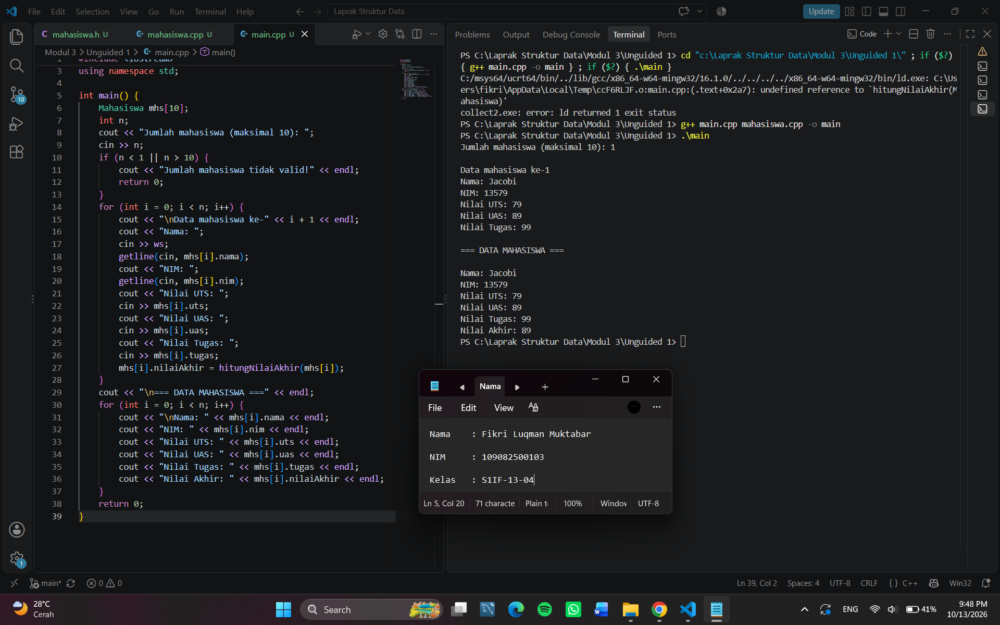
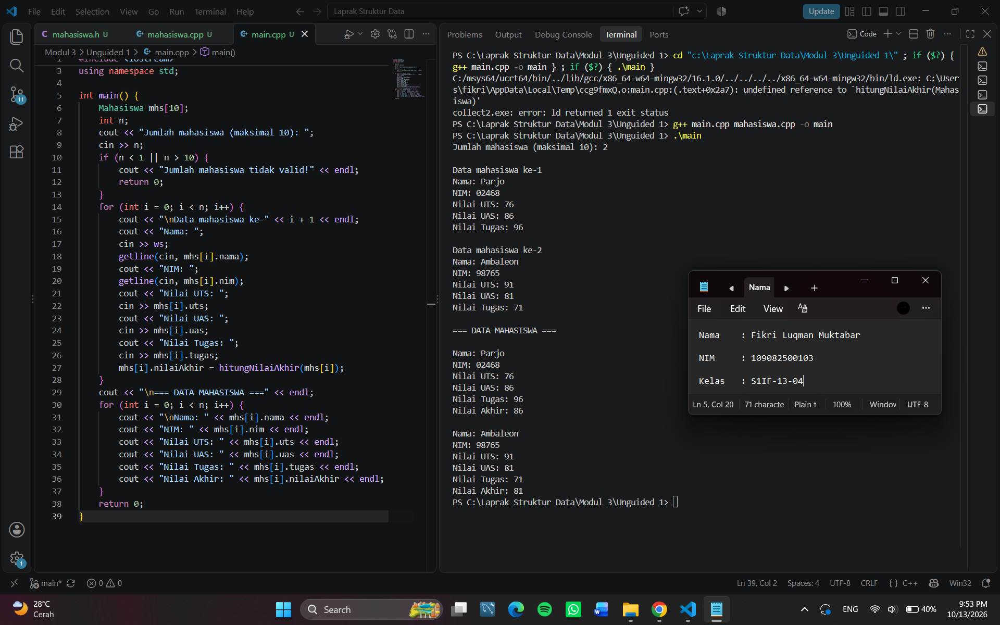
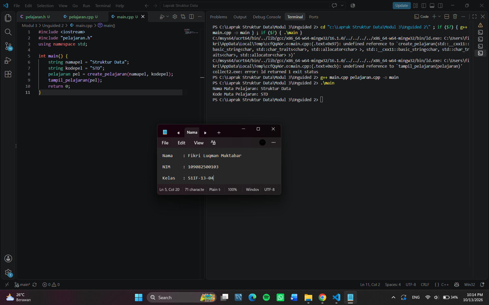
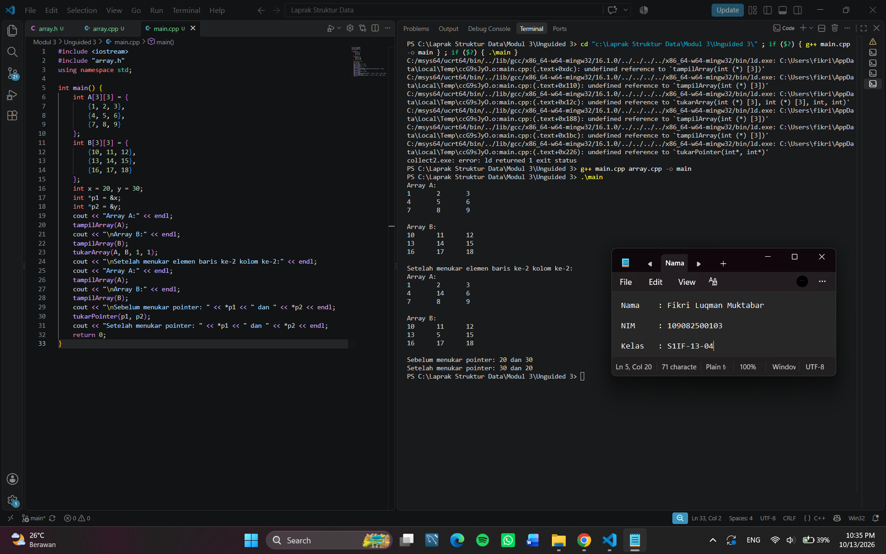
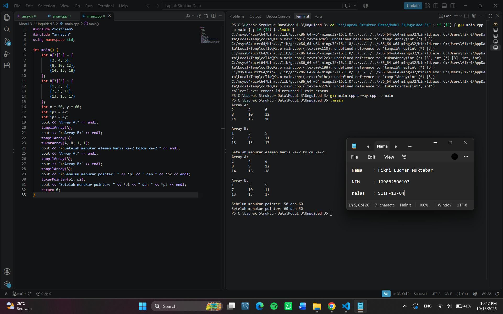

# <h1 align="center">Laporan Praktikum Modul 3 - Abstract Data Type (ADT)</h1>

<p align="center">Fikri Luqman Muktabar - 109082500103</p>

## Dasar Teori
Abstract Data Type (ADT) merupakan konsep dalam pemrograman yang menggabungkan tipe data dengan operasi yang digunakan untuk mengolah data tersebut. ADT membantu program menjadi lebih terstruktur karena data dan operasi yang berkaitan dapat diatur secara terpisah. Dalam bahasa C++, ADT dapat diterapkan menggunakan struct, fungsi, dan prosedur. Implementasi ADT juga dapat dibagi ke beberapa file agar kode lebih mudah dipahami dan dikembangkan.

### A. Abstract Data Type (ADT)<br/>
Abstract Data Type (ADT) adalah konsep yang terdiri dari tipe data dan sekumpulan operasi dasar yang dapat digunakan untuk mengolah data tersebut. ADT membantu programmer menentukan data apa yang digunakan dan operasi apa saja yang bisa dilakukan terhadap data tersebut.

#### 1. Tipe Data (Type)
Tipe data digunakan untuk menentukan bentuk data yang akan disimpan. Dalam C++, tipe data pada ADT dapat dibuat menggunakan struct yang berisi beberapa komponen. Contohnya, data mahasiswa dapat memiliki komponen NIM, nilai pertama, dan nilai kedua.

#### 2. Primitif ADT
Primitif ADT merupakan operasi dasar yang digunakan untuk mengolah data. Primitif ini dapat berupa operasi untuk membuat data, mengambil nilai, mengubah komponen, memeriksa data, serta membaca dan menampilkan data. Jenis operasi yang digunakan disesuaikan dengan kebutuhan ADT.

#### 3. Konstruktor atau Kreator
Konstruktor atau kreator merupakan operasi yang digunakan untuk membentuk atau membuat suatu nilai dari tipe data ADT. Operasi ini membantu menyiapkan data agar dapat digunakan oleh bagian program lainnya.

#### 4. Selector dan Mutator
Selector merupakan operasi yang digunakan untuk mengambil atau mengakses nilai dari komponen data. Sementara itu, mutator merupakan operasi yang digunakan untuk mengubah nilai suatu komponen. Keduanya membantu proses pengelolaan data agar lebih teratur.

#### 5. Validator, Destruktor, dan Operasi Lainnya
Validator digunakan untuk memeriksa apakah suatu data memenuhi ketentuan tertentu. Destruktor atau deallocator digunakan untuk menghapus atau membebaskan data yang sudah tidak diperlukan. Selain itu, primitif ADT juga dapat berupa operasi baca dan tulis, operasi relasional, operasi aritmatika, serta konversi tipe data sesuai kebutuhan program.

#### 6. Implementasi ADT
Implementasi ADT dapat dibagi menjadi beberapa file. File .h digunakan untuk mendefinisikan tipe data dan mendeklarasikan fungsi atau prosedur. File .cpp digunakan untuk menuliskan isi atau implementasi fungsi dan prosedur tersebut. Sementara itu, file main.cpp digunakan sebagai program utama untuk memanggil dan menguji operasi ADT. Pemisahan ini membuat susunan program lebih rapi dan mudah dipahami.

## Guided

### 1. buku.h

```C++
#ifndef BUKU_H
#define BUKU_H
#include <iostream>

using namespace std;

struct buku
{
    string judul;
    int halaman;
    string penulis;
};

void editIsi(string judul, int halaman, string penulis, buku &buku);
void tampilkanIsiBuku(buku buku);
bool checkPenulis(buku buku);

#endif 
```

### Penjelasan Singkat Guided 1
File buku.h digunakan untuk menyimpan deklarasi struktur buku yang memiliki field judul bertipe string, halaman bertipe int, dan penulis bertipe string. #include <iostream> digunakan untuk mendukung kebutuhan input dan output, sedangkan using namespace std; agar dapat menggunakan fitur standar C++ tanpa menuliskan awalan std::.
Fungsi editIsi() digunakan untuk mengubah isi data buku melalui parameter reference buku &buku. Fungsi tampilkanIsiBuku() digunakan untuk menampilkan informasi buku, sedangkan fungsi checkPenulis() digunakan untuk memeriksa penulis buku dan mengembalikan nilai bertipe bool (true atau false).
Bagian #ifndef BUKU_H, #define BUKU_H, dan #endif digunakan sebagai include guard agar isi file header tidak didefinisikan berulang kali ketika disertakan dalam program.

### 2. buku.cpp

```C++
#include "buku.h"

void editIsi(string judul, int halaman, string penulis, buku &buku) {
    buku.judul = judul;
    buku.halaman = halaman;
    buku.penulis = penulis;
}

void tampilkanIsiBuku(buku buku) {
    cout << "Judul buku : " << buku.judul << endl;
    cout << "Halaman buku : " << buku.halaman << endl;
    cout << "Penulis buku : " << buku.penulis << endl;
}

bool checkPenulis(buku buku) {
    return buku.penulis == "";
}
```

### Penjelasan Singkat Guided 2
File buku.cpp digunakan untuk menuliskan implementasi fungsi-fungsi yang telah dideklarasikan pada file buku.h. Fungsi editIsi() digunakan untuk mengisi atau mengubah judul, jumlah halaman, dan penulis buku melalui parameter reference sehingga perubahan tersimpan pada data buku. Fungsi tampilkanIsiBuku() digunakan untuk menampilkan judul, jumlah halaman, dan penulis buku menggunakan cout. Sementara itu, fungsi checkPenulis() digunakan untuk memeriksa apakah nama penulis kosong dengan membandingkan buku.penulis dengan string kosong (""). Fungsi ini mengembalikan nilai true jika nama penulis kosong dan false jika nama penulis terisi.

### 3. main.cpp

```C++
#include <iostream>
#include "buku.h"

using namespace std;

int main() {
    buku novel;

    string judul, penulis;
    int halaman;

    cout << "Masukkan judul buku : ";
    cin >> judul;
    cout << "Masukkan halaman buku : ";
    cin >> halaman;
    cout << "Masukkan penulis buku : ";
    cin >> penulis;

    editIsi(judul, halaman, penulis, novel);
    tampilkanIsiBuku(novel);

    cout << checkPenulis(novel) << endl;
    
    return 0;
}
```

### Penjelasan Singkat Guided 3
File main.cpp digunakan untuk menjalankan program utama dan menguji fungsi-fungsi yang telah dibuat pada file buku.h dan buku.cpp. Program membuat variabel novel bertipe buku, kemudian meminta pengguna memasukkan judul buku, jumlah halaman, dan nama penulis. Selanjutnya, fungsi editIsi() digunakan untuk menyimpan data yang dimasukkan ke dalam variabel novel, lalu fungsi tampilkanIsiBuku() digunakan untuk menampilkan informasi buku tersebut. Terakhir, fungsi checkPenulis() dipanggil untuk memeriksa apakah nama penulis kosong. Hasilnya ditampilkan menggunakan cout, dengan nilai 1 jika nama penulis kosong dan 0 jika nama penulis terisi.

## Unguided

### 1. Buat program yang dapat menyimpan data mahasiswa (max. 10) ke dalam sebuah array dengan field nama, nim, uts, uas, tugas, dan nilai akhir. Nilai akhir diperoleh dari FUNGSI dengan rumus 0.3 * uts + 0.4 * uas + 0.3 * tugas.

### mahasiswa.h
```C++
#ifndef MAHASISWA_H
#define MAHASISWA_H

#include <string>
using namespace std;

struct Mahasiswa {
    string nama;
    string nim;
    float uts, uas, tugas;
    float nilaiAkhir;
};
float hitungNilaiAkhir(Mahasiswa m);
#endif
```

### mahasiswa.cpp
```C++
#include "mahasiswa.h"

float hitungNilaiAkhir(Mahasiswa m) {
    return 0.3 * m.uts + 0.4 * m.uas + 0.3 * m.tugas;
}
```

### main.cpp
```C++
#include <iostream>
#include "mahasiswa.h"
using namespace std;

int main() {
    Mahasiswa mhs[10];
    int n;
    cout << "Jumlah mahasiswa (maksimal 10): ";
    cin >> n;
    if (n < 1 || n > 10) {
        cout << "Jumlah mahasiswa tidak valid!" << endl;
        return 0;
    }
    for (int i = 0; i < n; i++) {
        cout << "\nData mahasiswa ke-" << i + 1 << endl;
        cout << "Nama: ";
        cin >> ws;
        getline(cin, mhs[i].nama);
        cout << "NIM: ";
        getline(cin, mhs[i].nim);
        cout << "Nilai UTS: ";
        cin >> mhs[i].uts;
        cout << "Nilai UAS: ";
        cin >> mhs[i].uas;
        cout << "Nilai Tugas: ";
        cin >> mhs[i].tugas;
        mhs[i].nilaiAkhir = hitungNilaiAkhir(mhs[i]);
    }
    cout << "\n=== DATA MAHASISWA ===" << endl;
    for (int i = 0; i < n; i++) {
        cout << "\nNama: " << mhs[i].nama << endl;
        cout << "NIM: " << mhs[i].nim << endl;
        cout << "Nilai UTS: " << mhs[i].uts << endl;
        cout << "Nilai UAS: " << mhs[i].uas << endl;
        cout << "Nilai Tugas: " << mhs[i].tugas << endl;
        cout << "Nilai Akhir: " << mhs[i].nilaiAkhir << endl;
    }
    return 0;
}
```

### Output Unguided 1 :

##### Output 1



##### Output 2



### Penjelasan Unguided 1
File mahasiswa.h digunakan untuk menyimpan deklarasi struktur mahasiswa yang memiliki field nama, nim, uts, uas, tugas, dan nilaiAkhir, serta deklarasi fungsi untuk menghitung nilai akhir mahasiswa. Kemudian file mahasiswa.cpp digunakan untuk menuliskan implementasi fungsi yang telah dideklarasikan pada file mahasiswa.h. Fungsi tersebut digunakan untuk menghitung nilai akhir mahasiswa berdasarkan rumus 0.3 * uts + 0.4 * uas + 0.3 * tugas. Lalu file main.cpp digunakan untuk menjalankan program utama, memasukkan data mahasiswa ke dalam array, menghitung nilai akhir menggunakan fungsi, dan menampilkan data mahasiswa beserta nilai akhirnya. Secara keseluruhan, program ini digunakan untuk menyimpan maksimal 10 data mahasiswa dalam array, yang meliputi nama, NIM, nilai UTS, UAS, tugas, dan nilai akhir. Nilai akhir dihitung menggunakan fungsi berdasarkan bobot nilai yang telah ditentukan, kemudian hasilnya ditampilkan.

### 2. Buatlah ADT pelajaran sebagai berikut, buatlah implementasinya, dan cobalah hasil implementasinya.

### pelajaran.h
```C++
#ifndef PELAJARAN_H
#define PELAJARAN_H

#include <string>
using namespace std;

struct pelajaran {
    string namaMapel;
    string kodeMapel;
};
pelajaran create_pelajaran(string namapel, string kodepel);
void tampil_pelajaran(pelajaran pel);
#endif
```

### pelajaran.cpp
```C++
#include <iostream>
#include "pelajaran.h"
using namespace std;

pelajaran create_pelajaran(string namapel, string kodepel) {
    pelajaran pel;
    pel.namaMapel = namapel;
    pel.kodeMapel = kodepel;
    return pel;
}
void tampil_pelajaran(pelajaran pel) {
    cout << "Nama Mata Pelajaran: " << pel.namaMapel << endl;
    cout << "Kode Mata Pelajaran: " << pel.kodeMapel << endl;
}
```

### main.cpp
```C++
#include <iostream>
#include "pelajaran.h"
using namespace std;

int main() {
    string namapel = "Struktur Data";
    string kodepel = "STD";
    pelajaran pel = create_pelajaran(namapel, kodepel);
    tampil_pelajaran(pel);
    return 0;
}
```

### Output Unguided 2 :

##### Output 1



### Penjelasan Unguided 2
File pelajaran.h digunakan untuk menyimpan deklarasi struktur pelajaran yang memiliki field namaMapel dan kodeMapel, serta deklarasi fungsi create_pelajaran() dan prosedur tampil_pelajaran(). Kemudian file pelajaran.cpp digunakan untuk menuliskan implementasi fungsi dan prosedur yang telah dideklarasikan pada file pelajaran.h. Fungsi create_pelajaran() digunakan untuk membuat data mata pelajaran berdasarkan nama dan kode yang diberikan, sedangkan prosedur tampil_pelajaran() digunakan untuk menampilkan data tersebut. Lalu file main.cpp digunakan untuk menjalankan program utama dengan menentukan nama mata pelajaran "Struktur Data" dan kode "STD". Selanjutnya, fungsi create_pelajaran() dipanggil untuk membuat data mata pelajaran, kemudian prosedur tampil_pelajaran() dipanggil untuk menampilkan nama dan kode mata pelajaran. Secara keseluruhan, program ini digunakan untuk menerapkan konsep Abstract Data Type (ADT) pada data mata pelajaran. Program memisahkan deklarasi struktur dan fungsi ke dalam file pelajaran.h, implementasi fungsi ke dalam file pelajaran.cpp, serta proses pemanggilan dan pengujian program ke dalam file main.cpp. Dengan demikian, data mata pelajaran dapat dibuat dan ditampilkan secara terstruktur.

### 3. Buatlah program dengan ketentuan :
- 2 buah array 2D integer berukuran 3x3 dan 2 buah pointer integer
- fungsi/prosedur yang menampilkan isi sebuah array integer 2D
- fungsi/prosedur yang akan menukarkan isi dari 2 array integer 2D pada posisi tertentu
- fungsi/prosedur yang akan menukarkan isi dari variabel yang ditunjuk oleh 2 buah pointer

### array.h
```C++
#ifndef ARRAY_H
#define ARRAY_H

void tampilArray(int arr[3][3]);

void tukarArray(int A[3][3], int B[3][3], int baris, int kolom);

void tukarPointer(int *p1, int *p2);

#endif
```

### array.cpp
```C++
#include <iostream>
#include "array.h"
using namespace std;

void tampilArray(int arr[3][3]) {
    for (int i = 0; i < 3; i++) {
        for (int j = 0; j < 3; j++) {
            cout << arr[i][j] << "\t";
        }
        cout << endl;
    }
}
void tukarArray(int A[3][3], int B[3][3], int baris, int kolom) {
    int temp = A[baris][kolom];
    A[baris][kolom] = B[baris][kolom];
    B[baris][kolom] = temp;
}
void tukarPointer(int *p1, int *p2) {
    int temp = *p1;
    *p1 = *p2;
    *p2 = temp;
}
```

### main.cpp
```C++
#include <iostream>
#include "array.h"
using namespace std;

int main() {
    int A[3][3] = {
        {1, 2, 3},
        {4, 5, 6},
        {7, 8, 9}
    };
    int B[3][3] = {
        {10, 11, 12},
        {13, 14, 15},
        {16, 17, 18}
    };
    int x = 50, y = 60;
    int *p1 = &x;
    int *p2 = &y;
    cout << "Array A:" << endl;
    tampilArray(A);
    cout << "\nArray B:" << endl;
    tampilArray(B);
    tukarArray(A, B, 1, 1);
    cout << "\nSetelah menukar elemen baris ke-2 kolom ke-2:" << endl;
    cout << "Array A:" << endl;
    tampilArray(A);
    cout << "\nArray B:" << endl;
    tampilArray(B);
    cout << "\nSebelum menukar pointer: " << *p1 << " dan " << *p2 << endl;
    tukarPointer(p1, p2);
    cout << "Setelah menukar pointer: " << *p1 << " dan " << *p2 << endl;
    return 0;
}
```

### Output Unguided 3 :

##### Output 1



##### Output 2



### Penjelasan Unguided 3
File array.h digunakan untuk menyimpan deklarasi fungsi yang akan digunakan dalam program. File ini berisi deklarasi fungsi tampilArray() untuk menampilkan isi array 2D, tukarArray() untuk menukar elemen dari dua array 2D pada posisi tertentu, dan tukarPointer() untuk menukar nilai dua variabel menggunakan pointer. Kemudian file array.cpp digunakan untuk menuliskan implementasi dari fungsi-fungsi yang telah dideklarasikan pada file array.h. Fungsi tampilArray() menggunakan perulangan for untuk menampilkan isi array, fungsi tukarArray() menukar elemen dari array A dan B menggunakan variabel sementara temp, sedangkan fungsi tukarPointer() menukar nilai dua variabel melalui pointer. Lalu file main.cpp digunakan untuk menjalankan program utama dan menguji fungsi-fungsi yang telah dibuat. Pada program ini, array A dan B masing-masing berukuran 3×3, kemudian ditampilkan menggunakan fungsi tampilArray(). Selanjutnya, fungsi tukarArray() digunakan untuk menukar elemen pada baris ke-2 kolom ke-2. Variabel x dan y digunakan untuk menguji fungsi tukarPointer(), sehingga nilai kedua variabel tersebut bertukar dari 20 dan 30 menjadi 30 dan 20. Secara keseluruhan, program ini digunakan untuk menampilkan isi dua array integer 2D berukuran 3×3, menukar elemen kedua array pada posisi tertentu, serta menukar nilai dua variabel menggunakan pointer. Pemisahan program menjadi file array.h, array.cpp, dan main.cpp membuat kode lebih terstruktur karena deklarasi fungsi, implementasi fungsi, dan program utama ditempatkan pada file yang berbeda.

## Kesimpulan
Berdasarkan praktikum yang telah dilakukan, dapat disimpulkan bahwa Abstract Data Type (ADT) membantu membuat program C++ menjadi lebih terstruktur dengan memisahkan deklarasi tipe data, implementasi fungsi, dan program utama ke dalam file yang berbeda. Melalui praktikum ini, ADT diterapkan untuk mengelola data buku, data mahasiswa, dan data mata pelajaran. Selain itu, praktikum juga mempelajari penggunaan array 2D dan pointer untuk menampilkan serta menukar nilai. Dengan menerapkan ADT, program menjadi lebih rapi, mudah dipahami, dan lebih mudah dikembangkan.

## Referensi

[1] Azzam, H. N., & Ubaidillah, A. S. (2025). Studi Perancangan dan Implementasi Sistem Kasir Sederhana Menggunakan Bahasa Pemrograman C++ pada Platform Code::Blocks. Jurnal Aplikasi Teknologi dan Komputasi.
<br>[2] Anggoro, H. B. (2013). Media Tutorial Pemrograman Bahasa C Berbasis Camtasia. Edu Elektrika Journal.
<br>