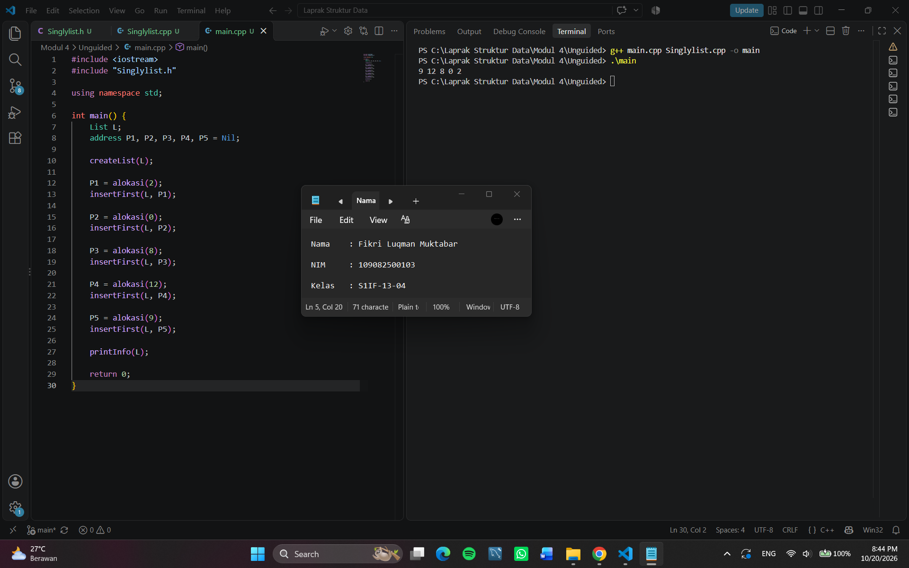

# <h1 align="center">Laporan Praktikum Modul 4 - Singly Linked List (Bagian Pertama)</h1>

<p align="center">Fikri Luqman Muktabar - 109082500103</p>

## Dasar Teori
Linked List merupakan struktur data yang terdiri dari beberapa elemen yang saling terhubung dan dapat bertambah atau berkurang sesuai kebutuhan. Setiap elemen menyimpan data dan pointer yang menunjuk ke elemen berikutnya. Dalam bahasa C++, Linked List dapat dibuat menggunakan pointer sehingga pengelolaan data lebih fleksibel dibandingkan array yang ukurannya bersifat statis. Operasi pada Linked List meliputi pembuatan list, penambahan elemen, penghapusan elemen, menampilkan data, pencarian, dan pengubahan data.

### A. Linked List<br/>
Linked List adalah struktur data yang menyimpan elemen-elemen yang saling terhubung melalui pointer. Setiap elemen memiliki data dan alamat yang menunjuk ke elemen lain. Linked List dapat digunakan untuk mengelola data secara fleksibel sesuai kebutuhan program.

#### 1. Linked List dengan Pointer
Linked List dengan pointer merupakan struktur data yang menghubungkan setiap elemen menggunakan pointer. Pointer digunakan karena lebih fleksibel dalam mengatur hubungan antarelemen dibandingkan array. Dengan pointer, elemen dapat ditambahkan atau dihapus tanpa harus mengatur ulang seluruh data.

#### 2. Singly Linked List
Singly Linked List merupakan jenis Linked List yang setiap elemennya hanya memiliki satu pointer untuk menunjuk ke elemen berikutnya. Elemen terakhir menunjuk ke Nil atau NULL sebagai tanda bahwa tidak ada elemen selanjutnya. Jenis list ini hanya dapat ditelusuri dari arah depan ke belakang.

#### 3. Struktur Elemen (Node)
Node merupakan bagian yang digunakan untuk menyimpan data dalam Linked List. Setiap node terdiri dari bagian data (info) dan pointer (next). Data yang disimpan dapat berupa satu nilai atau beberapa informasi, seperti nama, NIM, dan umur mahasiswa.

#### 4. Pointer first, next, dan Nil
Pointer first digunakan untuk menunjuk elemen pertama dalam list, sedangkan next digunakan untuk menunjuk alamat elemen berikutnya. Sementara itu, Nil atau NULL menunjukkan pointer kosong yang tidak menunjuk ke elemen mana pun. Ketiga bagian ini digunakan untuk menghubungkan dan menelusuri elemen dalam Linked List.

#### 5. Operasi pada Linked List
Operasi dasar Linked List meliputi Create List untuk membuat list kosong, Insert untuk menambahkan elemen, Delete untuk menghapus elemen, dan View untuk menampilkan isi list. Selain itu, terdapat operasi Searching untuk mencari data dan Update untuk mengubah data yang tersimpan.

#### 6. Penyisipan dan Penghapusan Elemen
Penyisipan elemen dapat dilakukan di awal, di tengah, atau di akhir list. Operasi ini menggunakan pointer untuk mengatur hubungan antarnode. Penghapusan elemen dilakukan dengan mengubah hubungan pointer dan membebaskan memori node yang sudah tidak digunakan.

#### 7. Implementasi Linked List dalam C++
Linked List dalam bahasa C++ dapat dibuat menggunakan struct dan pointer. Struktur node digunakan untuk menyimpan data (info) dan pointer (next) yang menunjuk ke elemen berikutnya. Dalam implementasi ADT Linked List, file .h digunakan untuk mendeklarasikan tipe data dan fungsi, sedangkan file .cpp digunakan untuk membuat implementasi dari operasi-operasi Linked List. Selanjutnya, file main.cpp digunakan untuk menjalankan dan menguji operasi tersebut. Dengan pembagian ini, program menjadi lebih terstruktur dan mudah dipahami.

## Guided

### 1. 

### list.h
```C++
#ifndef List_h
#define List_h
#define Nil NULL

#include <iostream>
using namespace std;

struct mahasiswa
{
    string nama, nim;
    int umur;
};

typedef mahasiswa dataMahasiswa;
typedef struct node *address;

struct node
{
    dataMahasiswa isidata;
    address next;
};

struct linkedlist
{
    address first;
};

bool isEmpty(linkedlist List);
void createList(linkedlist &List);
address alokasi(string nama, string nim, int umur);
void dealokasi(address &node);
void printList(linkedlist List);
void insertFirst(linkedlist &list, address nodeBaru);
void insertAfter(linkedlist &list, address nodeBaru, address prev);
void insertLast(linkedlist &list, address nodeBaru);

void delFirst(linkedlist &list);
void delLast(linkedlist &list);
void delAfter(linkedlist &list, address nodeHapus, address nodePrev);
int nbList(linkedlist list);
void deleteList(linkedlist &list);
#endif
```

### Penjelasan Singkat 
list.h digunakan untuk menyimpan deklarasi struktur Singly Linked List yang berisi data mahasiswa berupa nama, NIM, dan umur. Struktur node digunakan untuk menyimpan data dan alamat node berikutnya, sedangkan linkedlist memiliki field first sebagai penunjuk node pertama.
#include <iostream> digunakan untuk mendukung input dan output, sedangkan using namespace std; agar fitur standar C++ dapat digunakan tanpa awalan std::. #define Nil NULL digunakan untuk menyatakan pointer kosong.
Fungsi dan prosedur yang dideklarasikan digunakan untuk membuat list, menambah dan menghapus node, menampilkan data mahasiswa, memeriksa list kosong, menghitung jumlah node, serta menghapus seluruh isi list. Bagian #ifndef List_h, #define List_h, dan #endif digunakan sebagai include guard agar deklarasi dalam file tidak diproses berulang kali.

### list.cpp
```C++
#include "list.h"
#include <iostream>
using namespace std;

bool isEmpty(linkedlist  List)
{
    if (List.first == Nil)
    {
        return true;
    }
    else 
    {
        return false;
    }
}

void createList(linkedlist &List)
{
    List.first = Nil;
}

address alokasi(string nama, string nim, int umur)
{
    address nodeBaru = new node;
    nodeBaru->isidata.nama = nama;
    nodeBaru->isidata.nim = nim;
    nodeBaru->isidata.umur = umur;
    nodeBaru->next = Nil;
    return nodeBaru;
}

void dealokasi(address &node)
{
    node->next = Nil;
    delete node;
}

void insertFirst(linkedlist &List, address nodeBaru)
{
    nodeBaru->next = List.first;
    List.first = nodeBaru;
}

void insertAfter(linkedlist &List, address nodeBaru, address Prev)
{
    if (Prev != Nil)
    {
        nodeBaru->next = Prev->next;
        Prev->next = nodeBaru;
    }
    else
    {
        cout << "Node sebelumnya tidak valid!" << endl;
    }
}

void insertLast(linkedlist &List, address nodeBaru)
{
    if (isEmpty(List))
    {
        List.first = nodeBaru;
    }
    else
    {
        address nodeBantu = List.first;
        while (nodeBantu->next != Nil)
        {
            nodeBantu = nodeBantu->next;
        }
        nodeBantu->next = nodeBaru;
    }
}

void delFirst(linkedlist &List)
{
    address nodeHapus;
    if (isEmpty(List) == false)
    {
        nodeHapus = List.first;
        List.first = List.first->next;
        nodeHapus->next = Nil;
        dealokasi(nodeHapus);
    }
    else
    {
        cout << "List kosong!" << endl;
    }
}

void delLast(linkedlist &List)
{
    address nodeHapus, nodePrev;
    if (isEmpty(List) == false)
    {
        nodeHapus = List.first;
        if (nodeHapus->next == Nil)
        {
            List.first->next = Nil;
            dealokasi(nodeHapus);
        }
        else
        {
            while (nodeHapus->next != Nil)
            {
                nodePrev = nodeHapus;
                nodeHapus = nodeHapus->next;
            }
            nodePrev->next = Nil;
            dealokasi(nodeHapus);
        }
    }
    else
    {
        cout << "List kosong" << endl;
    }
}

void delAfter(linkedlist &List, address nodeHapus, address nodePrev)
{
    if (isEmpty(List) == true)
    {
        cout << "List kosong!" << endl;
    }
    else
    {
        if (nodePrev != Nil && nodePrev->next != Nil)
        {
            nodeHapus = nodePrev->next;
            nodePrev->next = nodeHapus->next;
            nodeHapus->next = Nil;
            dealokasi(nodeHapus);
        }
        else
        {
            cout << "Node sebelumnya (prev) tidak valid!" << endl;
        }
    }
}

void printList(linkedlist list)
{
    if (isEmpty(list) == true)
    {
        cout << "List kosong!" << endl;
    }
    else
    {
        address nodeBantu = list.first;
        while (nodeBantu != Nil)
        {
            cout << "Nama: " << nodeBantu->isidata.nama << ", NIM: " << nodeBantu->isidata.nim << ", Usia: " << nodeBantu->isidata.umur << endl;
            nodeBantu = nodeBantu->next;
        }
    }
}

int nbList(linkedlist list)
{
    int count = 0;
    address nodeBantu = list.first;
    while (nodeBantu != Nil)
    {
        count++;
        nodeBantu = nodeBantu->next;
    }
    return count;
}

void deleteList(linkedlist &list)
{
    address nodeBantu, nodeHapus;
    nodeBantu = list.first;
    while (nodeBantu != Nil)
    {
        nodeHapus = nodeBantu;
        nodeBantu = nodeBantu->next;
        dealokasi(nodeHapus);
    }
    list.first = Nil;
    cout << "List sudah terhapus." << endl;
}
```

### Penjelasan Singkat 
list.cpp digunakan untuk menuliskan implementasi fungsi dan prosedur yang telah dideklarasikan pada file list.h. Fungsi isEmpty() digunakan untuk memeriksa apakah list kosong, createList() untuk membuat list kosong, dan alokasi() serta dealokasi() untuk membuat dan menghapus node. Prosedur insertFirst(), insertAfter(), dan insertLast() digunakan untuk menambahkan node, sedangkan delFirst(), delLast(), dan delAfter() digunakan untuk menghapus node. Selain itu, printList() digunakan untuk menampilkan data mahasiswa, nbList() untuk menghitung jumlah node, dan deleteList() untuk menghapus seluruh isi list.

### main.cpp
```C++
#include "list.h"
using namespace std;

int main()
{
    linkedlist List;
    address nodeA, nodeB, nodeC, nodeD, nodeE = Nil;
    createList(List);

    nodeA = alokasi("Dhimas", "2311102151", 20);
    nodeB = alokasi("Arvin", "221110014", 21);
    nodeC = alokasi("Rizal", "231110029", 20);
    nodeD = alokasi("Satrio", "2211102173", 21);
    nodeE = alokasi("Joshua", "2311102133", 21);

    insertFirst(List, nodeA);
    insertLast(List, nodeB);
    insertAfter(List, nodeC, nodeA);
    insertAfter(List, nodeD, nodeC);
    insertLast(List, nodeE);

    cout << "--- ISI LIST SETELAH DILAKUKAN INSERT ---" << endl;
    printList(List);
    cout << "jumlah node : " << nbList(List) << endl;
    cout << endl;

    delFirst(List);
}
```

### Penjelasan Singkat 
main.cpp digunakan untuk menjalankan program utama dengan membuat list kosong dan mengalokasikan lima node yang berisi data mahasiswa berupa nama, NIM, dan umur. Prosedur insertFirst(), insertLast(), dan insertAfter() digunakan untuk menambahkan node ke dalam list. Selanjutnya, printList() digunakan untuk menampilkan data mahasiswa dan nbList() untuk menghitung jumlah node. Terakhir, delFirst() digunakan untuk menghapus node pertama dalam list.

## Unguided

### 1. Buatlah ADT Singly Linked list di dalam file “Singlylist.h”. Kemudian buat implementasi ADT Singly Linked list pada file “Singlylist.cpp”. Dan cobalah hasil implementasi ADT pada file “main.cpp”

### Singlylist.h
```C++
#ifndef SINGLYLIST_H_INCLUDED
#define SINGLYLIST_H_INCLUDED

#define Nil NULL

typedef int infotype;
typedef struct ElmList *address;

struct ElmList {
    infotype info;
    address next;
};

struct List {
    address First;
};

void createList(List &L);
address alokasi(infotype x);
void dealokasi(address &P);
void printInfo(List L);
void insertFirst(List &L, address P);

#endif
```

### Singlylist.cpp
```C++
#include <iostream>
#include "Singlylist.h"

using namespace std;

void createList(List &L) {
    L.First = Nil;
}

address alokasi(infotype x) {
    address P = new ElmList;
    P->info = x;
    P->next = Nil;
    return P;
}

void dealokasi(address &P) {
    delete P;
    P = Nil;
}

void printInfo(List L) {
    address P = L.First;
    while (P != Nil) {
        cout << P->info << " ";
        P = P->next;
    }
    cout << endl;
}

void insertFirst(List &L, address P) {
    P->next = L.First;
    L.First = P;
}
```

### main.cpp
```C++
#include <iostream>
#include "Singlylist.h"

using namespace std;

int main() {
    List L;
    address P1, P2, P3, P4, P5 = Nil;

    createList(L);

    P1 = alokasi(2);
    insertFirst(L, P1);

    P2 = alokasi(0);
    insertFirst(L, P2);

    P3 = alokasi(8);
    insertFirst(L, P3);

    P4 = alokasi(12);
    insertFirst(L, P4);

    P5 = alokasi(9);
    insertFirst(L, P5);

    printInfo(L);

    return 0;
}
```

### Output Unguided :

##### Output 1



### Penjelasan Unguided 
Singlylist.h digunakan untuk menyimpan deklarasi struktur data Singly Linked List yang memiliki field info untuk menyimpan nilai data dan next untuk menyimpan alamat elemen berikutnya. File ini juga berisi deklarasi struktur List dengan field First sebagai penunjuk elemen pertama, serta deklarasi fungsi dan prosedur untuk membuat list, mengalokasikan dan menghapus memori, menampilkan data, dan menambahkan elemen di awal list. 
Kemudian, Singlylist.cpp digunakan untuk menuliskan implementasi fungsi dan prosedur yang telah dideklarasikan pada file Singlylist.h. CreateList digunakan untuk membuat list kosong, alokasi digunakan untuk membuat elemen baru dan menyimpan nilai ke dalamnya, dealokasi digunakan untuk menghapus elemen dari memori, printInfo digunakan untuk menampilkan seluruh data dalam list, sedangkan insertFirst digunakan untuk menambahkan elemen baru di bagian awal list.
Lalu, main.cpp digunakan untuk menjalankan program utama, membuat list kosong, mengalokasikan lima elemen dengan nilai 2, 0, 8, 12, dan 9, kemudian memasukkan setiap elemen ke bagian awal list menggunakan insertFirst. Setelah semua elemen dimasukkan, program menampilkan isi list menggunakan printInfo. Secara keseluruhan, program ini digunakan untuk mempelajari penerapan struktur data Singly Linked List, mulai dari membuat list, menambahkan elemen di awal list, hingga menampilkan seluruh data. Karena setiap elemen dimasukkan di bagian awal, hasil yang ditampilkan adalah 9 12 8 0 2.

## Kesimpulan
Berdasarkan praktikum yang telah dilakukan, dapat disimpulkan bahwa Singly Linked List merupakan struktur data yang menghubungkan setiap elemen menggunakan pointer. Pada praktikum ini, dipelajari cara membuat list, menambahkan elemen di awal list, menampilkan data, serta mengelola memori menggunakan alokasi dan dealokasi. Implementasi program dibagi menjadi file .h untuk deklarasi, file .cpp untuk implementasi fungsi dan prosedur, serta main.cpp untuk menjalankan program. Dengan menggunakan Singly Linked List, data dapat dikelola secara lebih fleksibel dan program menjadi lebih terstruktur serta.

## Referensi

[1] Azzam, H. N., & Ubaidillah, A. S. (2025). Studi Perancangan dan Implementasi Sistem Kasir Sederhana Menggunakan Bahasa Pemrograman C++ pada Platform Code::Blocks. Jurnal Aplikasi Teknologi dan Komputasi.
<br>[2] Anggoro, H. B. (2013). Media Tutorial Pemrograman Bahasa C Berbasis Camtasia. Edu Elektrika Journal.
<br>