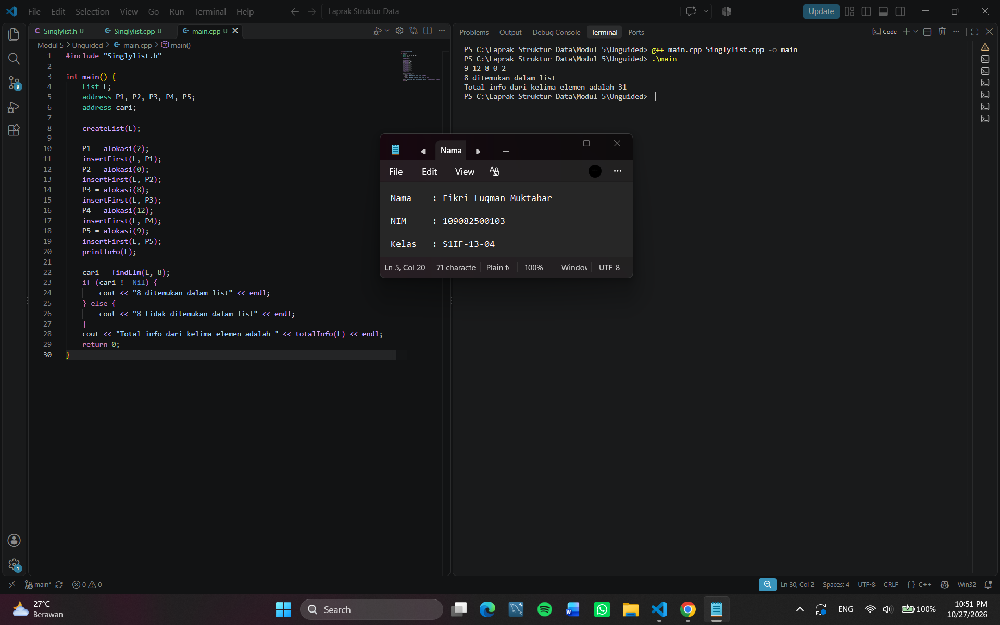

# <h1 align="center">Laporan Praktikum Modul 5 - Singly Linked List (Bagian Kedua)</h1>

<p align="center">Fikri Luqman Muktabar - 109082500103</p>

## Dasar Teori
Linked list merupakan struktur data yang terdiri dari beberapa node yang saling terhubung menggunakan pointer. Setiap node menyimpan data dan alamat node berikutnya. Pada singly linked list, hubungan antarnode hanya mengarah ke satu arah, yaitu dari node saat ini ke node berikutnya. Salah satu operasi yang dapat dilakukan pada struktur data ini adalah searching, yaitu mencari data tertentu dengan menelusuri node satu per satu hingga data ditemukan atau mencapai akhir list.

### A. Singly Linked List<br/>
Singly linked list adalah struktur data yang setiap nodenya memiliki bagian untuk menyimpan informasi dan pointer yang menunjukkan alamat node berikutnya. Struktur ini digunakan untuk menyimpan dan mengolah kumpulan data yang saling terhubung.

#### 1. Struktur Node
Node merupakan bagian utama dari linked list yang terdiri dari info untuk menyimpan data dan next untuk menyimpan alamat node berikutnya. Pointer next akan bernilai NULL jika node tersebut merupakan node terakhir dalam list.

#### 2. Pointer dan Alokasi Memori
Pointer digunakan untuk menyimpan alamat memori suatu node sehingga setiap node dapat terhubung dengan node lainnya. Alokasi memori dilakukan ketika membuat node baru, sedangkan dealokasi digunakan untuk membebaskan memori ketika node tidak lagi digunakan.

#### 3. Abstract Data Type (ADT) Linked List
ADT linked list digunakan untuk mengatur data dan operasi yang dapat dilakukan pada list. Beberapa operasi yang digunakan antara lain createList() untuk membuat list kosong, alokasi() untuk membuat node baru, dealokasi() untuk membebaskan memori, dan printInfo() untuk menampilkan isi list.

### B. Searching pada Singly Linked List<br/>
Searching merupakan proses mencari data tertentu di dalam linked list dengan menelusuri node mulai dari awal list. Proses ini dilakukan sampai data yang dicari ditemukan atau seluruh node selesai diperiksa.

#### 1. Proses Searching
Proses searching dimulai dari node pertama, kemudian data pada setiap node diperiksa satu per satu. Jika data yang dicari ditemukan, proses dapat dihentikan. Jika tidak ditemukan sampai akhir list, berarti data tersebut tidak ada di dalam list.

#### 2. Fungsi findElm()
Fungsi findElm() digunakan untuk mencari node yang memiliki nilai sesuai dengan data yang dicari. Fungsi ini menelusuri list melalui pointer next dan memeriksa nilai pada setiap node sampai data ditemukan atau mencapai akhir list.

#### 3. Penelusuran dan Pengolahan Data
Penelusuran node tidak hanya digunakan untuk mencari data, tetapi juga dapat membantu pengolahan isi linked list. Pada praktikum ini, penelusuran dilakukan untuk mencari nilai tertentu, seperti nilai 8, serta menjumlahkan seluruh nilai yang terdapat di dalam list.

## Guided

### list.h
```C++
#ifndef List_h
#define List_h
#define Nil NULL

#include <iostream>
using namespace std;

struct mahasiswa
{
    string nama, nim;
    int umur;
};

typedef mahasiswa dataMahasiswa;
typedef struct node *address;

struct node
{
    dataMahasiswa isidata;
    address next;
};

struct linkedList
{
    address first;
};

bool isEmpty(linkedList List);
void createList(linkedList &List);
address alokasi(string nama, string nim, int umur);
void dealokasi(address &node);
void printList(linkedList List);
void insertFirst(linkedList &List, address nodeBaru);
void insertLast(linkedList &List, address nodeBaru);
void insertAfter(linkedList &List, address nodeBaru, address prev);
void delFirst(linkedList &List);
void delLast(linkedList &List);
void delAfter(linkedList &List, address nodeHapus, address nodePrev);
int nbList(linkedList List);
void deleteList(linkedList &List);

address FindNodebyData(linkedList List, string data);
void FindNodebyAddress(linkedList List, address node);
void FindNodeByRange(linkedList List, int nilaiAwal, int nilaiAkhir);

void updateFirst(linkedList &list);
void updateLast(linkedList &list);
void updateAfter(linkedList &list, address &prev);
void updateByNim(linkedList &list, string nim);

#endif
```

### Penjelasan Singkat 
list.h digunakan untuk menyimpan deklarasi struktur Singly Linked List yang berisi data mahasiswa berupa nama, NIM, dan umur. Struktur node digunakan untuk menyimpan data mahasiswa dan alamat node berikutnya, sedangkan linkedList memiliki field first sebagai penunjuk node pertama.
#include <iostream> digunakan untuk mendukung input dan output, sedangkan using namespace std; agar fitur standar C++ dapat digunakan tanpa awalan std::. #define Nil NULL digunakan untuk menyatakan pointer kosong.
Fungsi dan prosedur yang dideklarasikan digunakan untuk membuat list, mengalokasikan dan menghapus memori, menambah dan menghapus node, menampilkan data mahasiswa, memeriksa apakah list kosong, menghitung jumlah node, serta menghapus seluruh isi list. Selain itu, terdapat fungsi untuk mencari node berdasarkan data, alamat, atau rentang nilai, serta prosedur untuk memperbarui data mahasiswa. Bagian #ifndef List_h, #define List_h, dan #endif digunakan sebagai include guard agar deklarasi dalam file tidak diproses berulang kali.

### list.cpp
```C++
#include "list.h"
#include <iostream>
using namespace std;

// I.S = Initial State / kondisi awal
// F.S = Final State / kondisi akhir

// fungsi untuk cek apakah list kosong atau tidak
bool isEmpty(linkedList List)
{
    if (List.first == Nil)
    {
        return true;
    }
    else
    {
        return false;
    }
}

// pembuatan linked list kosong
void createList(linkedList &List)
{
    /* I.S. sembarang
       F.S. terbentuk list kosong */
    List.first = Nil;
}

// pembuatan node baru dengan menerapkan manajemen memori
address alokasi(string nama, string nim, int umur)
{
    /* I.S. sembarang
       F.S. mengembalikan alamat node baru dengan isidata = sesuai parameter dan next = Nil */
    address nodeBaru = new node;
    nodeBaru->isidata.nama = nama;
    nodeBaru->isidata.nim = nim;
    nodeBaru->isidata.umur = umur;
    nodeBaru->next = Nil;
    return nodeBaru;
}

// penghapusan node dengan menerapkan manajemen memori
void dealokasi(address &node)
{
    /* I.S. P terdefinisi
       F.S. memori yang digunakan node dikembalikan ke sistem */
    node->next = Nil;
    delete node;
}

// prosedur-prosedur untuk insert / menambahkan node baru kedalam list
void insertFirst(linkedList &List, address nodeBaru)
{
    /* I.S. sembarang, P sudah dialokasikan
       F.S. menempatkan elemen list (node) pada awal list */
    nodeBaru->next = List.first;
    List.first = nodeBaru;
}

void insertAfter(linkedList &List, address nodeBaru, address Prev)
{
    /* I.S. sembarang, nodeBaru dan Prev alamat salah satu elemen list (node)
       F.S. menempatkan elemen (node) sesudah elemen node Prev */
    if (Prev != Nil)
    {
        nodeBaru->next = Prev->next;
        Prev->next = nodeBaru;
    }
    else
    {
        cout << "Node sebelumnya tidak valid!" << endl;
    }
}

void insertLast(linkedList &List, address nodeBaru)
{
    /* I.S. sembarang, nodeBaru sudah dialokasikan
       F.S. menempatkan elemen nodeBaru pada akhir list */
    if (isEmpty(List))
    {
        List.first = nodeBaru;
    }
    else
    {
        address nodeBantu = List.first;
        while (nodeBantu->next != Nil)
        {
            nodeBantu = nodeBantu->next;
        }
        nodeBantu->next = nodeBaru;
    }
}

// prosedur-prosedur untuk delete / menghapus node yang ada didalam list
void delFirst(linkedList &List)
{
    /* I.S. list tidak kosong
    F.S. node pertama di list terhapus*/
    address nodeHapus;
    if (isEmpty(List) == false)
    {
        nodeHapus = List.first;
        List.first = List.first->next;
        nodeHapus->next = Nil;
        dealokasi(nodeHapus);
    }
    else
    {
        cout << "List kosong!" << endl;
    }
}

void delLast(linkedList &List)
{
    /* I.S. list tidak kosong
    F.S. node terakhir di list terhapus */
    address nodeHapus, nodePrev;
    if (isEmpty(List) == false)
    {
        nodeHapus = List.first;
        if (nodeHapus->next == Nil)
        {
            List.first->next = Nil;
            dealokasi(nodeHapus);
        }
        else
        {
            while (nodeHapus->next != Nil)
            {
                nodePrev = nodeHapus;
                nodeHapus = nodeHapus->next;
            }
            nodePrev->next = Nil;
            dealokasi(nodeHapus);
        }
    }
    else
    {
        cout << "list kosong" << endl;
    }
}

void delAfter(linkedList &List, address nodeHapus, address nodePrev)
{
    /* I.S. list tidak kosng, Prev alamat salah satu elemen list
    F.S. nodeBantu adalah alamat dari Prev→next, menghapus Prev→next dari list */
    if (isEmpty(List) == true)
    {
        cout << "List kosong!" << endl;
    }
    else
    { // jika list tidak kosong
        if (nodePrev != Nil && nodePrev->next != Nil)
        {
            nodeHapus = nodePrev->next;
            nodePrev->next = nodeHapus->next;
            nodeHapus->next = Nil;
            dealokasi(nodeHapus);
        }
        else
        {
            cout << "Node sebelumnya (prev) tidak valid!" << endl;
        }
    }
}

// prosedur untuk menampilkan isi list
void printList(linkedList List)
{
    /* I.S. list mungkin kosong
       F.S. jika list tidak kosong menampilkan semua info yang ada pada list */
    if (isEmpty(List))
    {
        cout << "List kosong." << endl;
    }
    else
    {
        address nodeBantu = List.first;
        while (nodeBantu != Nil)
        {
            cout << "Nama : " << nodeBantu->isidata.nama << ", NIM : " << nodeBantu->isidata.nim << ", Usia : " << nodeBantu->isidata.umur << endl;
            nodeBantu = nodeBantu->next;
        }
    }
}

// function untuk menampilkan jumlah node didalam list
int nbList(linkedList List)
{
    /* I.S. list sudah ada
       F.S. menampilkan jumlah node didalam list*/
    int count = 0;
    address nodeBantu = List.first;
    while (nodeBantu != Nil)
    {
        count++;
        nodeBantu = nodeBantu->next;
    }
    return count;
}

// prosedur untuk menghapus list (menghapus semua node didalam list)
void deleteList(linkedList &List)
{
    /* I.S. list sudah ada
       F.S. menghapus semua node didalam list*/
    address nodeBantu, nodeHapus;
    nodeBantu = List.first;
    while (nodeBantu != Nil)
    {
        nodeHapus = nodeBantu;
        nodeBantu = nodeBantu->next;
        dealokasi(nodeHapus);
    }
    List.first = Nil;
    cout << "List sudah terhapus!" << endl;
}

// prosedur-prosedur untuk melakukan update data node
void updateFirst(linkedList &list)
{
    dataMahasiswa newData;
    cout << "Masukan nama baru : ";
    cin >> newData.nama;
    cout << "Masukan nim baru : ";
    cin >> newData.nim;
    cout << "Masukan umur baru : ";
    cin >> newData.umur;
    list.first->isidata = newData;
}

void updateLast(linkedList &list)
{
    if (isEmpty(list))
    {
        cout << "List kosong!" << endl;
    }
    else
    {
        dataMahasiswa newData;
        cout << "Masukan nama baru : ";
        cin >> newData.nama;
        cout << "Masukan nim baru : ";
        cin >> newData.nim;
        cout << "Masukan umur baru : ";
        cin >> newData.umur;

        address nodeBantu = list.first;
        while (nodeBantu->next != Nil)
        {
            nodeBantu = nodeBantu->next;
        }

        nodeBantu->isidata = newData;
    }
}

void updateAfter(linkedList &list, address &prev)
{
    if (isEmpty(list))
    {
        cout << "List kosong!" << endl;
    }
    else
    {
        dataMahasiswa newData;
        cout << "Masukan nama baru : ";
        cin >> newData.nama;
        cout << "Masukan nim baru : ";
        cin >> newData.nim;
        cout << "Masukan umur baru : ";
        cin >> newData.umur;

        prev->next->isidata = newData;
    }
}

void updateByNim(linkedList &list, string nim)
{
    if (!isEmpty(list))
    {
        address nodeBantu = FindNodebyData(list, nim);

        if (nodeBantu != Nil)
        {
            dataMahasiswa newData;
            cout << "Masukan nama baru : ";
            cin >> newData.nama;
            cout << "Masukan nim baru : ";
            cin >> newData.nim;
            cout << "Masukan umur baru : ";
            cin >> newData.umur;

            nodeBantu->isidata = newData;
        }
    }
    else
    {
        cout << "List kosong!" << endl;
    }
}

// prosedur-prosedur untuk searching data didalam list
address FindNodebyData(linkedList List, string data)
{
    /* I.S. list mungkin kosong
       F.S. menampilkan node yang sesuai dengan nama atau nim yang dicari */
    if (isEmpty(List) == true)
    {
        cout << "List kosong!" << endl;
    }
    else
    {
        address nodeBantu = List.first;
        int posisi = 0;
        bool found = false;
        while (nodeBantu != Nil)
        {
            posisi++;
            if (nodeBantu->isidata.nama == data || nodeBantu->isidata.nim == data)
            {
                cout << "Data " << data << " ditemukan pada posisi ke-" << posisi << "!" << endl;
                cout << "Nama : " << nodeBantu->isidata.nama << ", NIM : " << nodeBantu->isidata.nim << ", Usia : " << nodeBantu->isidata.umur << endl;
                found = true;
                break;
            }
            nodeBantu = nodeBantu->next;
        }
        if (found == false)
        {
            cout << "Node dengan data " << data << " tidak ditemukan!" << endl;
        }
    }
    cout << endl;
    return Nil;
}

void FindNodebyAddress(linkedList List, address node)
{
    /* I.S. list mungkin kosong
       F.S. menampilkan node yang sesuai dengan alamat yang dicari */
    if (isEmpty(List) == true)
    {
        cout << "List kosong!" << endl;
    }
    else
    {
        address nodeBantu = List.first;
        int posisi = 0;
        bool found = false;
        while (nodeBantu != Nil)
        {
            posisi++;
            if (nodeBantu == node)
            {
                cout << "Node ditemukan pada posisi ke-" << posisi << "!" << endl;
                cout << "Alamat Node : " << nodeBantu << endl;
                cout << "Nama : " << nodeBantu->isidata.nama << ", NIM : " << nodeBantu->isidata.nim << ", Usia : " << nodeBantu->isidata.umur << endl;
                found = true;
                break;
            }
            nodeBantu = nodeBantu->next;
        }
        if (found == false)
        {
            cout << "Node dengan alamat " << node << " tidak ditemukan dalam list!" << endl;
        }
    }
    cout << endl;
}

void FindNodeByRange(linkedList List, int nilaiAwal, int nilaiAkhir)
{
    /* I.S. list mungkin kosong
       F.S. menampilkan semua node yang memiliki umur di dalam rentang nilaiAwal sampai nilaiAkhir */
    if (isEmpty(List) == true)
    {
        cout << "List kosong!" << endl;
    }
    else
    {
        address nodeBantu = List.first;
        int posisi = 0;
        bool found = false;
        cout << "--- Data diatas usia " << nilaiAwal << " dan dibawah " << nilaiAkhir << " ---" << endl;
        while (nodeBantu != Nil)
        {
            posisi++;
            int umur = nodeBantu->isidata.umur;
            if (umur > nilaiAwal && umur < nilaiAkhir)
            {
                cout << "Data ditemukan pada posisi ke-" << posisi << " :" << endl;
                cout << "Nama : " << nodeBantu->isidata.nama << ", NIM : " << nodeBantu->isidata.nim << ", Usia : " << nodeBantu->isidata.umur << endl;
                found = true;
            }
            nodeBantu = nodeBantu->next;
        }
        if (found == false)
        {
            cout << "Tidak ada data node dalam range tersebut!" << endl;
        }
    }
    cout << endl;
}
```

### Penjelasan Singkat 
list.cpp digunakan untuk menuliskan implementasi fungsi dan prosedur yang telah dideklarasikan pada file list.h. Fungsi isEmpty() digunakan untuk memeriksa apakah list kosong, createList() untuk membuat list kosong, serta alokasi() dan dealokasi() untuk membuat dan menghapus node. Prosedur insertFirst(), insertAfter(), dan insertLast() digunakan untuk menambahkan node, sedangkan delFirst(), delLast(), dan delAfter() digunakan untuk menghapus node. Selain itu, printList() digunakan untuk menampilkan data mahasiswa, nbList() untuk menghitung jumlah node, dan deleteList() untuk menghapus seluruh isi list.
File ini juga memiliki fungsi FindNodebyData() untuk mencari node berdasarkan nama atau NIM, FindNodebyAddress() untuk mencari node berdasarkan alamat, dan FindNodeByRange() untuk mencari data mahasiswa berdasarkan rentang umur. Sementara itu, updateFirst(), updateLast(), updateAfter(), dan updateByNim() digunakan untuk memperbarui data mahasiswa pada node tertentu.

### main.cpp
```C++
#include <iostream>
#include "list.h"
using namespace std;

int main()
{
    linkedList List;
    address nodeA, nodeB, nodeC, nodeD, nodeE = Nil;
    createList(List);

    nodeA = alokasi("Dhimas", "2311102151", 20);
    nodeB = alokasi("Arvin", "2211110014", 21);
    nodeC = alokasi("Rizal", "2311110029", 20);
    nodeD = alokasi("Satrio", "2211102173", 21);
    nodeE = alokasi("Joshua", "2311102133", 21);

    insertFirst(List, nodeA);
    insertLast(List, nodeB);
    insertAfter(List, nodeC, nodeA);
    insertAfter(List, nodeD, nodeC);
    insertLast(List, nodeE);

    cout << "--- ISI LIST SETELAH DILAKUKAN INSERT ---" << endl;
    printList(List);
    cout << "jumlah node : " << nbList(List) << endl;
    cout << endl;

    // updateFirst(List);
    // cout << "--- ISI LIST SETELAH DILAKUKAN UPDATE FIRST ---" << endl;
    // printList(List);

    // updateLast(List);
    // cout << "--- ISI LIST SETELAH DILAKUKAN UPDATE LAST ---" << endl;
    // printList(List);

    updateAfter(List, nodeC);
    cout << "--- ISI LIST SETELAH DILAKUKAN UPDATE AFTER ---" << endl;
    printList(List);

    updateByNim(List, "2211110014");
    cout << "--- ISI LIST SETELAH DILAKUKAN UPDATE BY NIM ---" << endl;
    printList(List);

    return 0;
}
```

### Penjelasan Singkat 
main.cpp digunakan untuk menjalankan program utama dengan membuat list kosong dan mengalokasikan lima node yang berisi data mahasiswa berupa nama, NIM, dan umur. Prosedur insertFirst(), insertLast(), dan insertAfter() digunakan untuk menambahkan node ke dalam list. Selanjutnya, printList() digunakan untuk menampilkan data mahasiswa dan nbList() untuk menghitung jumlah node. Terakhir, updateAfter() digunakan untuk memperbarui data mahasiswa setelah node tertentu, sedangkan updateByNim() digunakan untuk memperbarui data mahasiswa berdasarkan NIM.

## Unguided

### Buatlah ADT Singly Linked list di dalam file “Singlylist.h”. Kemudian buat implementasi ADT Singly Linked list pada file “Singlylist.cpp”. Dan cobalah hasil implementasi ADT pada file “main.cpp”

### Singlylist.h
```C++
#ifndef SINGLYLIST_H
#define SINGLYLIST_H

#include <iostream>
using namespace std;

#define Nil NULL

typedef int infotype;
typedef struct ElmList *address;

struct ElmList {
    infotype info;
    address next;
};

struct List {
    address First;
};

void createList(List &L);
address alokasi(infotype x);
void dealokasi(address &P);
void printInfo(List L);
void insertFirst(List &L, address P);
address findElm(List L, infotype x);
int totalInfo(List L);

#endif
```

### Singlylist.cpp
```C++
#include "Singlylist.h"

void createList(List &L) {
    L.First = Nil;
}

address alokasi(infotype x) {
    address P = new ElmList;
    P->info = x;
    P->next = Nil;
    return P;
}

void dealokasi(address &P) {
    delete P;
    P = Nil;
}

void printInfo(List L) {
    address P = L.First;
    while (P != Nil) {
        cout << P->info << " ";
        P = P->next;
    }
    cout << endl;
}

void insertFirst(List &L, address P) {
    P->next = L.First;
    L.First = P;
}

address findElm(List L, infotype x) {
    address P = L.First;
    while (P != Nil) {
        if (P->info == x) {
            return P;
        }
        P = P->next;
    }
    return Nil;
}

int totalInfo(List L) {
    address P = L.First;
    int total = 0;
    while (P != Nil) {
        total += P->info;
        P = P->next;
    }
    return total;
}
```

### main.cpp
```C++
#include "Singlylist.h"

int main() {
    List L;
    address P1, P2, P3, P4, P5;
    address cari;

    createList(L);

    P1 = alokasi(2);
    insertFirst(L, P1);
    P2 = alokasi(0);
    insertFirst(L, P2);
    P3 = alokasi(8);
    insertFirst(L, P3);
    P4 = alokasi(12);
    insertFirst(L, P4);
    P5 = alokasi(9);
    insertFirst(L, P5);
    printInfo(L);

    cari = findElm(L, 8);
    if (cari != Nil) {
        cout << "8 ditemukan dalam list" << endl;
    } else {
        cout << "8 tidak ditemukan dalam list" << endl;
    }
    cout << "Total info dari kelima elemen adalah " << totalInfo(L) << endl;
    return 0;
}
```

### Output Unguided :

##### Output 1



### Penjelasan Unguided 
Singlylist.h digunakan untuk menyimpan deklarasi struktur data Singly Linked List yang memiliki field info untuk menyimpan nilai data dan next untuk menyimpan alamat elemen berikutnya. File ini juga berisi deklarasi struktur List dengan field First sebagai penunjuk elemen pertama, serta deklarasi fungsi dan prosedur untuk membuat list, mengalokasikan dan menghapus memori, menampilkan data, menambahkan elemen di awal list, mencari elemen, dan menghitung jumlah seluruh nilai.

Kemudian, Singlylist.cpp digunakan untuk menuliskan implementasi fungsi dan prosedur yang telah dideklarasikan pada file Singlylist.h. createList digunakan untuk membuat list kosong, alokasi digunakan untuk membuat elemen baru dan menyimpan nilai ke dalamnya, dealokasi digunakan untuk menghapus elemen dari memori, printInfo digunakan untuk menampilkan seluruh data dalam list, sedangkan insertFirst digunakan untuk menambahkan elemen baru di bagian awal list. Selain itu, findElm digunakan untuk mencari elemen berdasarkan nilai yang ditentukan, dan totalInfo digunakan untuk menghitung jumlah seluruh nilai dalam list.

Lalu, main.cpp digunakan untuk menjalankan program utama, membuat list kosong, mengalokasikan lima elemen dengan nilai 2, 0, 8, 12, dan 9, kemudian memasukkan setiap elemen ke bagian awal list menggunakan insertFirst. Setelah semua elemen dimasukkan, program menampilkan isi list menggunakan printInfo, mencari elemen bernilai 8 menggunakan findElm, dan menghitung jumlah seluruh nilai menggunakan totalInfo. 

Secara keseluruhan, program ini digunakan untuk mempelajari penerapan struktur data Singly Linked List, mulai dari membuat list, menambahkan elemen di awal list, mencari data, hingga menghitung jumlah seluruh nilai. Karena setiap elemen dimasukkan di bagian awal, hasil urutan data yang ditampilkan adalah 9 12 8 0 2, dengan jumlah seluruh nilai sebesar 31.

## Kesimpulan
Berdasarkan praktikum yang telah dilakukan, dapat disimpulkan bahwa Singly Linked List merupakan struktur data yang menghubungkan setiap elemen menggunakan pointer. Pada praktikum ini, dipelajari cara membuat list, menambahkan elemen di awal list, menampilkan data, serta mengelola memori menggunakan alokasi dan dealokasi. Selain itu, fungsi findElm() digunakan untuk mencari elemen dengan nilai tertentu, sedangkan fungsi totalInfo() digunakan untuk menjumlahkan seluruh nilai dalam list. Dari hasil program, diperoleh urutan data 9, 12, 8, 0, dan 2 dengan jumlah seluruh nilai sebesar 31. Dengan praktikum ini, dapat dipahami cara menerapkan Singly Linked List untuk menyimpan, mencari, dan mengolah data secara terstruktur.

## Referensi

[1] Mbejo, M. T., Nopa, L. A., Putri, J. S., & Risky, M. (2025). Analisis Struktur Data Linked List Dalam Pengolahan Data Mahasiswa. Jurnal Sains Informatika Terapan, 4(2), 441–444.
<br>[2] Fitra, M. R. A., Effendi, A. A. S., & Ramadhani, F. (2025). Implementasi Python dalam Pengolahan Data Pribadi Mahasiswa Ilmu Komputer Angkatan 23 pada Universitas Negeri Medan Menggunakan Struktur Data Linked List. JATI (Jurnal Mahasiswa Teknik Informatika), 9(1), 51–58.
<br>