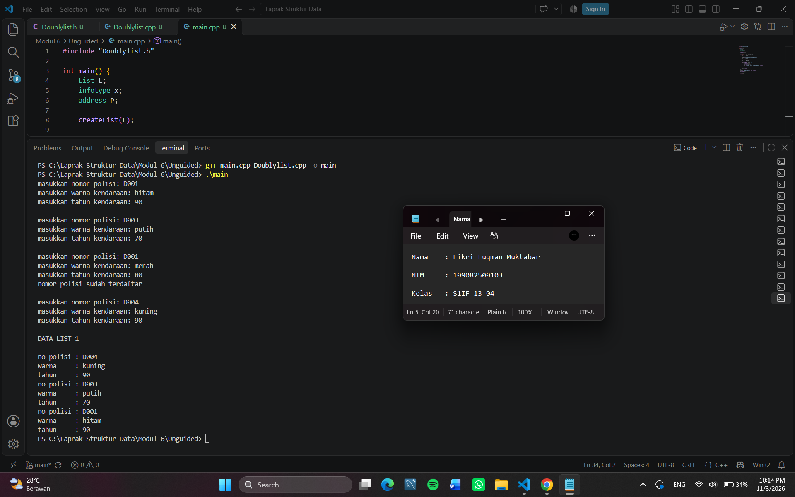
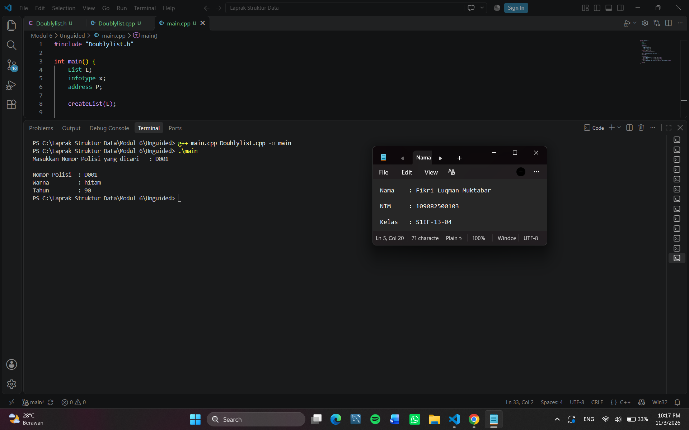
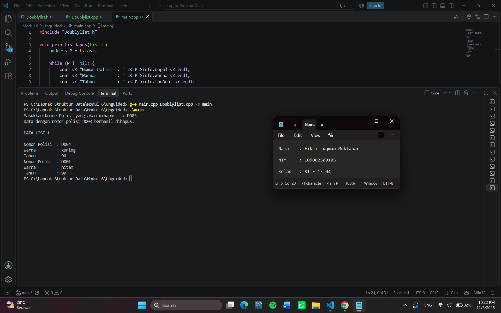

# <h1 align="center">Laporan Praktikum Modul 6 - Doubly Linked List (Bagian Pertama)</h1>

<p align="center">Fikri Luqman Muktabar - 109082500103</p>

## Dasar Teori
Linked list adalah struktur data yang terdiri dari sejumlah node yang dihubungkan secara linier dengan bantuan pointer [1]. Berbeda dengan array, ukuran linked list bersifat dinamis sehingga memori dialokasikan hanya saat elemen dibutuhkan. Salah satu jenisnya adalah Doubly Linked List, yaitu linked list yang setiap elemennya memiliki dua successor: successor yang menunjuk ke elemen sebelumnya (prev) dan successor yang menunjuk ke elemen sesudahnya (next) [2].

### A. Konsep Doubly Linked List<br/>
Doubly Linked List menggunakan dua penunjuk utama pada list, yaitu first dan last. List dinyatakan kosong jika first bernilai Nil. Karena setiap elemen menyimpan alamat elemen sebelum dan sesudahnya, penelusuran dapat dilakukan maju maupun mundur [2].

#### 1. Komponen Doubly Linked List
Doubly Linked List memiliki empat komponen. First adalah pointer pada list yang menunjuk ke elemen pertama list. Last adalah pointer pada list yang menunjuk ke elemen terakhir list. Next adalah pointer pada elemen sebagai successor yang menunjuk ke elemen di depannya, sedangkan Prev adalah pointer pada elemen sebagai successor yang menunjuk ke elemen di belakangnya.

#### 2. Bentuk Doubly Linked List
Pada list kosong, first dan last bernilai Nil. Pada list dengan tiga elemen, first menunjuk ke Elemen 1 dan last menunjuk ke Elemen 3. Pointer prev pada Elemen 1 dan pointer next pada Elemen 3 bernilai Nil (NULL), sebagai penanda awal dan akhir list.

#### 3. Struktur Data
Setiap elemen list (elmlist) terdiri dari field info untuk menyimpan data, serta field next dan prev untuk menyimpan alamat elemen berikutnya dan sebelumnya. Sementara itu, list itu sendiri terdiri dari field first dan last yang bertipe address, yaitu pointer ke elemen. Pada ADT Doubly Linked List, fungsi dan prosedur primitif lainnya sama dengan Singly Linked List.

### B. Operasi Insert<br/>
Insert adalah proses menambahkan elemen baru ke dalam list. Setiap proses insert diawali dengan pembuatan elemen baru melalui fungsi alokasi, kemudian pointer next dan prev elemen baru tersebut diisi Nil sebelum dihubungkan ke dalam list.

#### 1. Insert First
Insert First adalah proses menyisipkan elemen baru sebagai elemen pertama list. Pointer next elemen baru diarahkan ke elemen yang sebelumnya pertama, pointer prev elemen pertama lama diarahkan ke elemen baru, lalu first pada list dipindahkan menunjuk ke elemen baru.

#### 2. Insert Last
Insert Last adalah proses menyisipkan elemen baru sebagai elemen terakhir list. Pointer prev elemen baru diarahkan ke elemen yang sebelumnya terakhir, pointer next elemen terakhir lama diarahkan ke elemen baru, lalu last pada list dipindahkan menunjuk ke elemen baru.

#### 3. Insert After
Insert After adalah proses menyisipkan elemen baru setelah elemen tertentu (R). Pointer next elemen baru diarahkan ke elemen setelah R, pointer prev elemen baru diarahkan ke R, pointer prev elemen setelah R diarahkan ke elemen baru, dan terakhir pointer next R diarahkan ke elemen baru.

#### 4. Insert Before
Insert Before merupakan kebalikan dari Insert After. Perbedaan keduanya terletak pada pencarian elemennya, yaitu elemen baru disisipkan sebelum elemen tertentu.

### C. Operasi Delete<br/>
Delete adalah proses menghapus elemen dari list. Elemen yang dilepas ditunjuk oleh pointer P, kemudian dikembalikan sebagai hasil atau dibebaskan dari memori dengan prosedur dealokasi.

#### 1. Delete First
Delete First adalah proses menghapus elemen pertama list. Pointer P diarahkan ke elemen pertama, first dipindahkan ke elemen berikutnya, lalu pointer prev elemen pertama yang baru dan pointer next elemen yang dilepas diisi Nil agar elemen tersebut terputus dari list.

#### 2. Delete Last
Delete Last adalah proses menghapus elemen terakhir list. Pointer P diarahkan ke elemen terakhir, last dipindahkan ke elemen sebelumnya, lalu pointer next elemen terakhir yang baru dan pointer prev elemen yang dilepas diisi Nil agar elemen tersebut terputus dari list.

#### 3. Delete After
Delete After adalah proses menghapus elemen yang berada setelah elemen tertentu (R). Pointer next R diarahkan ke elemen setelah elemen yang dihapus, pointer prev elemen setelahnya diarahkan kembali ke R, lalu pointer next dan prev elemen yang dilepas diisi Nil.

#### 4. Delete Before
Delete Before merupakan kebalikan dari Delete After. Perbedaan keduanya terletak pada pencarian elemennya, yaitu elemen yang dihapus berada sebelum elemen tertentu.

### D. Update, View, dan Searching<br/>
Proses pencarian, update data, dan view data pada dasarnya sama dengan proses pada Singly Linked List. Perbedaannya, Doubly Linked List lebih mudah dalam melakukan akses elemen karena iterasi dapat dilakukan maju (melalui next) maupun mundur (melalui prev) [2]. Seperti halnya Singly Linked List, Doubly Linked List juga memiliki ADT yang pada dasarnya sama dengan ADT pada Singly Linked List.

## Guided

### listMakanan.h
```C++
#ifndef LISTMAKANAN_H
#define LISTMAKANAN_H
#define Nil NULL

#include <iostream>
using namespace std;

struct makanan
{
    string nama;
    string jenis;
    float harga;
    float rating;
};

typedef makanan dataMakanan;

typedef struct node *address;

struct node
{
    dataMakanan isidata;
    address next;
    address prev;
};

struct linkedlist
{
    address first;
    address last;
};

bool isEmpty(linkedlist List);
void createList(linkedlist &List);
address alokasi(string nama, string jenis, float harga, float rating);
void dealokasi(address &node);

void insertFirst(linkedlist &List, address nodeBaru);
void insertLast(linkedlist &List, address nodeBaru);
void insertAfter(linkedlist &List, address nodeBaru, address Prev);
void insertBefore(linkedlist &List, address nodeBaru, address nodeNext);

void printList(linkedlist List);

void updateFirst(linkedlist List);
void updateLast(linkedlist List);
void updateAfter(linkedlist List, address prev);
void updateBefore(linkedlist List, address nodeNext);

// Searching
void findByName(linkedlist List, string nama);
void findByJenis(linkedlist List, string jenis);
void findByMinRating(linkedlist List, float minRating);

// Delete
void deleteFirst(linkedlist &List);
void deleteLast(linkedlist &List);
void deleteAfter(linkedlist &List, address Prev);
void deleteBefore(linkedlist &List, address nodeNext);

void deleteNode(linkedlist &List, address target);
void deleteByName(linkedlist &List, string nama);

#endif
```

### Penjelasan Singkat
listMakanan.h digunakan untuk mendeklarasikan struktur Doubly Linked List yang menyimpan data makanan berupa nama, jenis, harga, dan rating. Struktur node memiliki field isidata, next, dan prev, sedangkan struktur linkedlist memiliki first dan last sebagai penunjuk node pertama dan terakhir.
#include <iostream> digunakan untuk mendukung input dan output, using namespace std; untuk menggunakan fitur standar C++ tanpa awalan std::, dan #define Nil NULL untuk menyatakan pointer kosong. Selain itu, typedef digunakan untuk membuat nama alias agar penulisan tipe data lebih singkat.
File ini juga berisi deklarasi fungsi dan prosedur untuk membuat list, mengelola memori node, menambah, menampilkan, mencari, memperbarui, dan menghapus data makanan. Sementara itu, #ifndef, #define, dan #endif digunakan sebagai include guard agar deklarasi tidak diproses berulang kali.

### listMakanan.cpp
```C++
#include "listMakanan.h"
#include <iostream>
#include <string>
using namespace std;

bool isEmpty(linkedlist List)
{
    if (List.first == Nil)
    {
        return true;
    }
    else
    {
        return false;
    }
}

void createList(linkedlist &List)
{
    List.first = Nil;
    List.last = Nil;
}

// pembuatan node baru dengan menerapkan manajemen memori
address alokasi(string nama, string jenis, float harga, float rating)
{
    address nodeBaru = new node;
    nodeBaru->isidata.nama = nama;
    nodeBaru->isidata.jenis = jenis;
    nodeBaru->isidata.harga = harga;
    nodeBaru->isidata.rating = rating;
    nodeBaru->next = Nil;
    nodeBaru->prev = Nil;
    return nodeBaru;
}

void dealokasi(address &node)
{
    node->next = Nil;
    node->prev = Nil;
    delete node;
}

void insertFirst(linkedlist &List, address nodeBaru)
{
    if (isEmpty(List))
    {
        List.first = List.last = nodeBaru;
    }
    else
    {
        nodeBaru->next = List.first;
        List.first->prev = nodeBaru;
        List.first = nodeBaru;
    }
    cout << "Node " << nodeBaru->isidata.nama << " berhasil ditambahkan sebagai node pertama list" << endl;
}

void insertLast(linkedlist &List, address nodeBaru)
{
    if (isEmpty(List) == true)
    {
        List.first = List.last = nodeBaru;
    }
    else
    {
        nodeBaru->prev = List.last;
        List.last->next = nodeBaru;
        List.last = nodeBaru;
    }
    cout << "Node " << nodeBaru->isidata.nama << " berhasil ditambahkan sebagai node terakhir list" << endl;
}

void insertAfter(linkedlist &List, address nodeBaru, address nodePrev)
{
    if (isEmpty(List) == true)
    {
        List.first = List.last = nodeBaru;
    }
    else
    {
        if (nodePrev != Nil)
        {
            if (nodePrev == List.last)
            {
                insertLast(List, nodeBaru);
            }
            else
            {
                nodeBaru->next = nodePrev->next;
                nodeBaru->prev = nodePrev;
                (nodePrev->next)->prev = nodeBaru;
                nodePrev->next = nodeBaru;
                cout << "Node " << nodeBaru->isidata.nama << " berhasil ditambahkan setelah node " << nodePrev->isidata.nama << endl;
            }
        }
        else
        {
            cout << "node sebelumnya (nodePrev) tidak valid!" << endl;
        }
    }
}

void insertBefore(linkedlist &List, address nodeBaru, address nodeNext)
{
    if (isEmpty(List) == true)
    {
        List.first = List.last = nodeBaru;
    }
    else
    {
        if (nodeNext != Nil)
        {
            if (nodeNext == List.first)
            {
                insertFirst(List, nodeBaru);
            }
            else
            {
                nodeBaru->next = nodeNext;
                nodeBaru->prev = nodeNext->prev;
                (nodeNext->prev)->next = nodeBaru;
                nodeNext->prev = nodeBaru;
                cout << "Node " << nodeBaru->isidata.nama << " berhasil ditambahkan sebelum node " << nodeNext->isidata.nama << endl;
            }
        }
        else
        {
            cout << "node setelahnya (nodeNext) tidak valid!" << endl;
        }
    }
}

void printList(linkedlist List)
{
    if (isEmpty(List) == true)
    {
        cout << "List kosong!" << endl;
    }
    else
    {
        address nodeBantu = List.first;
        while (nodeBantu != Nil)
        {
            cout << "Nama makanan : " << nodeBantu->isidata.nama << endl;
            cout << "Jenis        : " << nodeBantu->isidata.jenis << endl;
            cout << "Harga        : " << nodeBantu->isidata.harga << endl;
            cout << "Rating       : " << nodeBantu->isidata.rating << endl;
            cout << "-------------------------------" << endl;
            nodeBantu = nodeBantu->next;
        }
    }
}

void updateFirst(linkedlist List)
{
    if (isEmpty(List) == true)
    {
        cout << "List kosong!" << endl;
    }
    else
    {
        cout << "Masukkan update data node pertama : " << endl;
        cout << "Nama makanan : ";
        getline(cin, List.first->isidata.nama);
        cout << "Jenis makanan : ";
        getline(cin, List.first->isidata.jenis);
        cout << "Harga : ";
        cin >> List.first->isidata.harga;
        cout << "Rating : ";
        cin >> List.first->isidata.rating;
        cin.ignore(); // menghapus karakter newline (/n) dari input buffer
        cout << "Data Berhasil Diupdate!" << endl;
        cout << endl;
    }
}

void updateLast(linkedlist List)
{
    if (isEmpty(List) == true)
    {
        cout << "List kosong!" << endl;
    }
    else
    {
        cout << "Masukkan update data node terakhir : " << endl;
        cout << "Nama makanan : ";
        getline(cin, List.last->isidata.nama);
        cout << "Jenis makanan : ";
        getline(cin, List.last->isidata.jenis);
        cout << "Harga : ";
        cin >> List.last->isidata.harga;
        cout << "Rating : ";
        cin >> List.last->isidata.rating;
        cin.ignore(); // menghapus karakter newline (/n) dari input buffer
        cout << "Data Berhasil Diupdate!" << endl;
        cout << endl;
    }
}

void updateAfter(linkedlist List, address nodePrev)
{
    if (isEmpty(List) == true)
    {
        cout << "List kosong!" << endl;
    }
    else
    {
        if (nodePrev != Nil && nodePrev->next != Nil)
        {
            address nodeBantu = nodePrev->next;
            cout << "masukkan update data node setelah node " << nodePrev->isidata.nama << " : " << endl;
            cout << "Nama makanan : ";
            getline(cin, nodeBantu->isidata.nama);
            cout << "Jenis makanan : ";
            getline(cin, nodeBantu->isidata.jenis);
            cout << "Harga : ";
            cin >> nodeBantu->isidata.harga;
            cout << "Rating : ";
            cin >> nodeBantu->isidata.rating;
            cin.ignore(); // menghapus karakter newline (/n) dari input buffer
            cout << "Data Berhasil Diupdate!" << endl;
            cout << endl;
        }
        else
        {
            cout << "Node sebelumnya (nodePrev) tidak valid!" << endl;
        }
    }
}

void updateBefore(linkedlist List, address nodeNext)
{
    if (isEmpty(List) == true)
    {
        cout << "List kosong!" << endl;
    }
    else
    {
        if (nodeNext != Nil && nodeNext->prev != Nil)
        {
            address nodeBantu = nodeNext->prev;
            cout << "masukkan update data node sebelum node " << nodeNext->isidata.nama << " : " << endl;
            cout << "Nama makanan : ";
            getline(cin, nodeBantu->isidata.nama);
            cout << "Jenis makanan : ";
            getline(cin, nodeBantu->isidata.jenis);
            cout << "Harga : ";
            cin >> nodeBantu->isidata.harga;
            cout << "Rating : ";
            cin >> nodeBantu->isidata.rating;
            cin.ignore(); // menghapus karakter newline (/n) dari input buffer
            cout << "Data Berhasil Diupdate!" << endl;
            cout << endl;
        }
        else
        {
            cout << "Node sebelumnya (prev) tidak valid!" << endl;
        }
    }
}

// SEARCHING
void findByName(linkedlist List, string nama)
{
    if (isEmpty(List))
    {
        cout << "List kosong!" << endl;
        return;
    }
    address p = List.first;
    while (p != Nil)
    {
        if (p->isidata.nama == nama)
        {
            cout << "Ditemukan (berdasarkan nama):" << endl;
            cout << "Nama makanan : " << p->isidata.nama << endl;
            cout << "Jenis        : " << p->isidata.jenis << endl;
            cout << "Harga        : " << p->isidata.harga << endl;
            cout << "Rating       : " << p->isidata.rating << endl;
            return;
        }
        p = p->next;
    }
    cout << "Data dengan nama \"" << nama << "\" tidak ditemukan." << endl;
}

void findByJenis(linkedlist List, string jenis)
{
    if (isEmpty(List))
    {
        cout << "List kosong!" << endl;
        return;
    }
    address p = List.last;
    while (p != Nil)
    {
        if (p->isidata.jenis == jenis)
        {
            cout << "Ditemukan (berdasarkan jenis):" << endl;
            cout << "Nama makanan : " << p->isidata.nama << endl;
            cout << "Jenis        : " << p->isidata.jenis << endl;
            cout << "Harga        : " << p->isidata.harga << endl;
            cout << "Rating       : " << p->isidata.rating << endl;
            return;
        }
        p = p->prev;
    }
    cout << "Data dengan jenis \"" << jenis << "\" tidak ditemukan." << endl;
}

void findByMinRating(linkedlist List, float minRating)
{
    if (isEmpty(List))
    {
        cout << "List kosong!" << endl;
        return;
    }
    address p = List.last;
    while (p != Nil)
    {
        if (p->isidata.rating >= minRating)
        {
            cout << "Ditemukan (rating >= " << minRating << "):" << endl;
            cout << "Nama makanan : " << p->isidata.nama << endl;
            cout << "Jenis        : " << p->isidata.jenis << endl;
            cout << "Harga        : " << p->isidata.harga << endl;
            cout << "Rating       : " << p->isidata.rating << endl;
            return;
        }
        p = p->prev;
    }
    cout << "Tidak ada data dengan rating >= " << minRating << "." << endl;
}

// DELETE
void deleteFirst(linkedlist &List)
{
    if (isEmpty(List) == true)
    {
        cout << "List kosong! Tidak ada node yang dihapus." << endl;
        return;
    }
    address pDel = List.first;
    if (List.first == List.last)
    {
        List.first = List.last = Nil;
    }
    else
    {
        List.first = pDel->next;
        List.first->prev = Nil;
        pDel->next = Nil;
    }
    pDel->prev = Nil;
    cout << "Node " << pDel->isidata.nama << " berhasil dihapus dari posisi pertama." << endl;
    dealokasi(pDel);
}

void deleteLast(linkedlist &List)
{
    if (isEmpty(List) == true)
    {
        cout << "List kosong! Tidak ada node yang dihapus." << endl;
        return;
    }
    address pDel = List.last;
    if (List.first == List.last)
    {
        List.first = List.last = Nil;
    }
    else
    {
        List.last = pDel->prev;
        List.last->next = Nil;
        pDel->prev = Nil;
    }
    pDel->next = Nil;
    cout << "Node " << pDel->isidata.nama << " berhasil dihapus dari posisi terakhir." << endl;
    dealokasi(pDel);
}

void deleteAfter(linkedlist &List, address Prev)
{
    if (isEmpty(List) == true)
    {
        cout << "List kosong! Tidak ada node yang dihapus." << endl;
        return;
    }
    if (Prev == Nil || Prev->next == Nil)
    {
        cout << "Node sebelumnya (Prev) tidak valid atau tidak ada node setelahnya!" << endl;
        return;
    }
    if (Prev->next == List.last)
    {
        deleteLast(List);
        return;
    }
    address pDel = Prev->next;
    Prev->next = pDel->next;
    pDel->next->prev = Prev;
    pDel->next = Nil;
    pDel->prev = Nil;
    cout << "Node " << pDel->isidata.nama << " berhasil dihapus setelah node " << Prev->isidata.nama << "." << endl;
    dealokasi(pDel);
}

void deleteBefore(linkedlist &List, address nodeNext)
{
    if (isEmpty(List) == true)
    {
        cout << "List kosong! Tidak ada node yang dihapus." << endl;
        return;
    }
    if (nodeNext == Nil || nodeNext->prev == Nil)
    {
        cout << "Node setelahnya (nodeNext) tidak valid atau tidak ada node sebelumnya!" << endl;
        return;
    }
    if (nodeNext->prev == List.first)
    {
        deleteFirst(List);
        return;
    }
    address pDel = nodeNext->prev;
    nodeNext->prev = pDel->prev;
    pDel->prev->next = nodeNext;
    pDel->next = Nil;
    pDel->prev = Nil;
    cout << "Node " << pDel->isidata.nama << " berhasil dihapus sebelum node " << nodeNext->isidata.nama << "." << endl;
    dealokasi(pDel);
}

void deleteNode(linkedlist &List, address target)
{
    if (isEmpty(List) == true || target == Nil)
    {
        cout << "Target tidak valid atau list kosong!" << endl;
        return;
    }
    if (target == List.first)
    {
        deleteFirst(List);
    }
    else if (target == List.last)
    {
        deleteLast(List);
    }
    else
    {
        address L = target->prev;
        address R = target->next;
        L->next = R;
        R->prev = L;
        target->next = Nil;
        target->prev = Nil;
        cout << "Node " << target->isidata.nama << " berhasil dihapus dari tengah list." << endl;
        dealokasi(target);
    }
}

void deleteByName(linkedlist &List, string nama)
{
    if (isEmpty(List))
    {
        cout << "List kosong! Tidak ada node yang dihapus." << endl;
        return;
    }

    address target = List.first;
    while (target != Nil && target->isidata.nama != nama)
    {
        target = target->next;
    }
    if (target == Nil)
    {
        cout << "Node dengan nama \"" << nama << "\" tidak ditemukan." << endl;
        return;
    }

    deleteNode(List, target);
    cout << "Node dengan nama \"" << nama << "\" telah dihapus dan didealokasi." << endl;
}
```

### Penjelasan Singkat 
listMakanan.cpp digunakan untuk mengimplementasikan fungsi dan prosedur yang telah dideklarasikan pada file listMakanan.h. Fungsi isEmpty() dan createList() digunakan untuk memeriksa dan membuat list kosong, sedangkan alokasi() dan dealokasi() digunakan untuk membuat serta menghapus node dari memori.
Prosedur insertFirst(), insertLast(), insertAfter(), dan insertBefore() digunakan untuk menambahkan node sesuai posisi, sedangkan deleteFirst(), deleteLast(), deleteAfter(), dan deleteBefore() digunakan untuk menghapus node. Selain itu, printList() digunakan untuk menampilkan seluruh data makanan.
Fungsi findByName(), findByJenis(), dan findByMinRating() digunakan untuk mencari data berdasarkan nama, jenis, dan rating minimal. Sementara itu, updateFirst(), updateLast(), updateAfter(), dan updateBefore() digunakan untuk memperbarui data pada posisi tertentu. Terakhir, deleteNode() dan deleteByName() digunakan untuk menghapus node berdasarkan alamat atau nama makanan.

### main.cpp
```C++
#include "listMakanan.h"
#include <iostream>

using namespace std;

int main()
{
    linkedlist List;
    address nodeA, nodeB, nodeC, nodeD, nodeE = Nil;
    createList(List);

    dataMakanan dtMakanan;

    nodeA = alokasi("Nasi Rames", "Makanan Berat", 10000, 8.5);
    nodeB = alokasi("Ayam Geprek", "Makanan Berat", 13000, 9.0);
    nodeC = alokasi("Risol Mayo", "Makanan Ringan", 3500, 8.8);
    nodeD = alokasi("Mie Ayam", "Makanan Berat", 15000, 9.9);
    nodeE = alokasi("Donat", "Makanan Ringan", 2000, 7.7);

    insertFirst(List, nodeD);
    insertLast(List, nodeE);
    insertAfter(List, nodeA, nodeD);
    insertBefore(List, nodeC, nodeE);
    insertLast(List, nodeB);
    cout << endl;

    // D - A - C - E - B
    cout << "--- Isi List Setelah Insert ---" << endl;
    printList(List);
    cout << endl;

    updateFirst(List);
    updateLast(List);
    updateBefore(List, nodeC);
    updateAfter(List, nodeA);

    cout << "--- Isi List Setelah Update ---" << endl;
    printList(List);

    cout << endl;

    findByName(List, "Nasgor");
    findByMinRating(List, 9.0);

    deleteByName(List, "Nasgor");
    deleteFirst(List);
    deleteBefore(List, nodeE);

    cout << endl
         << "--- Isi List Setelah Delete ---" << endl;
    printList(List);

    return 0;
}
```

### Penjelasan Singkat 
main.cpp digunakan untuk menjalankan program utama dengan membuat list kosong dan mengalokasikan lima node berisi data makanan. Prosedur insertFirst(), insertLast(), insertAfter(), dan insertBefore() digunakan untuk menambahkan data ke dalam list sesuai posisi yang ditentukan. Selanjutnya, printList() menampilkan seluruh data makanan.
Kemudian, updateFirst(), updateLast(), updateBefore(), dan updateAfter() digunakan untuk memperbarui data pada node tertentu melalui input pengguna. Setelah itu, findByName() digunakan untuk mencari makanan bernama “Nasgor”, sedangkan findByMinRating() mencari makanan dengan rating minimal 9.0.
Terakhir, deleteByName(), deleteFirst(), dan deleteBefore() digunakan untuk menghapus node berdasarkan nama atau posisi tertentu. Setelah proses selesai, printList() menampilkan sisa data dalam list. Hasil pencarian dan penghapusan “Nasgor” bergantung pada data yang dimasukkan saat proses update.

## Unguided

### Buatlah ADT Doubly Linked list di dalam file “Doublylist.h”. Kemudian buat implementasi ADT Doubly Linked list pada file “Doublylist.cpp”. Dan cobalah hasil implementasi ADT pada file “main.cpp”

### Doublylist.h
```C++
#ifndef Doublylist_H
#define Doublylist_H

#include <iostream>
#include <string>
using namespace std;

#define Nil NULL

typedef struct kendaraan {
    string nopol;
    string warna;
    int thnBuat;
} infotype;

typedef struct ElmList *address;

struct ElmList {
    infotype info;
    address next;
    address prev;
};

struct List {
    address first;
    address last;
};

void createList(List &L);
address alokasi(infotype x);
void dealokasi(address &P);
void printInfo(List L);
void insertLast(List &L, address P);

address findElm(List L, infotype x);

void deleteFirst(List &L, address &P);
void deleteLast(List &L, address &P);
void deleteAfter(address Prec, address &P);

#endif
```

### Doublylist.cpp
```C++
#include "Doublylist.h"

void createList(List &L) {
    L.first = Nil;
    L.last = Nil;
}

address alokasi(infotype x) {
    address P = new ElmList;

    P->info = x;
    P->next = Nil;
    P->prev = Nil;

    return P;
}

void dealokasi(address &P) {
    delete P;
    P = Nil;
}

void insertLast(List &L, address P) {
    if (L.first == Nil) {
        L.first = P;
        L.last = P;
    } else {
        P->prev = L.last;
        L.last->next = P;
        L.last = P;
    }
}

void printInfo(List L) {
    address P = L.last;

    while (P != Nil) {
        cout << "no polisi : " << P->info.nopol << endl;
        cout << "warna     : " << P->info.warna << endl;
        cout << "tahun     : " << P->info.thnBuat << endl;
        P = P->prev;
    }
}

address findElm(List L, infotype x) {
    address P = L.first;

    while (P != Nil) {
        if (P->info.nopol == x.nopol) {
            return P;
        }
        P = P->next;
    }

    return Nil;
}

void deleteFirst(List &L, address &P) {
    P = L.first;

    if (L.first == L.last) {
        L.first = Nil;
        L.last = Nil;
    } else {
        L.first = L.first->next;
        L.first->prev = Nil;
    }

    P->next = Nil;
    P->prev = Nil;
}

void deleteLast(List &L, address &P) {
    P = L.last;

    if (L.first == L.last) {
        L.first = Nil;
        L.last = Nil;
    } else {
        L.last = L.last->prev;
        L.last->next = Nil;
    }

    P->next = Nil;
    P->prev = Nil;
}

void deleteAfter(address Prec, address &P) {
    P = Prec->next;

    Prec->next = P->next;

    if (P->next != Nil) {
        P->next->prev = Prec;
    }

    P->next = Nil;
    P->prev = Nil;
}
```

### main.cpp
```C++
#include "Doublylist.h"

void printListHapus(List L) {
    address P = L.last;

    while (P != Nil) {
        cout << "Nomor Polisi  : " << P->info.nopol << endl;
        cout << "Warna         : " << P->info.warna << endl;
        cout << "Tahun         : " << P->info.thnBuat << endl;
        P = P->prev;
    }
}

int main() {
    List L;
    infotype x;
    address P, hapus;

    createList(L);

    for (int i = 1; i <= 4; i++) {
        cout << "masukkan nomor polisi: ";
        cin >> x.nopol;

        cout << "masukkan warna kendaraan: ";
        cin >> x.warna;

        cout << "masukkan tahun kendaraan: ";
        cin >> x.thnBuat;

        if (findElm(L, x) == Nil) {
            P = alokasi(x);
            insertLast(L, P);
        } else {
            cout << "nomor polisi sudah terdaftar" << endl;
        }

        cout << endl;
    }

    cout << "DATA LIST 1" << endl << endl;
    printInfo(L);
    cout << endl;

    cout << "Masukkan Nomor Polisi yang dicari   : ";
    cin >> x.nopol;
    cout << endl;

    P = findElm(L, x);
    if (P != Nil) {
        cout << "Nomor Polisi  : " << P->info.nopol << endl;
        cout << "Warna         : " << P->info.warna << endl;
        cout << "Tahun         : " << P->info.thnBuat << endl;
    } else {
        cout << "Data dengan nomor polisi " << x.nopol << " tidak ditemukan." << endl;
    }
    cout << endl;

    cout << "Masukkan Nomor Polisi yang akan dihapus   : ";
    cin >> x.nopol;

    P = findElm(L, x);
    if (P != Nil) {
        if (P == L.first) {
            deleteFirst(L, hapus);
        } else if (P == L.last) {
            deleteLast(L, hapus);
        } else {
            deleteAfter(P->prev, hapus);
        }

        dealokasi(hapus);
        cout << "Data dengan nomor polisi " << x.nopol << " berhasil dihapus." << endl;
    } else {
        cout << "Data dengan nomor polisi " << x.nopol << " tidak ditemukan." << endl;
    }

    cout << endl;
    cout << "DATA LIST 1" << endl << endl;
    printListHapus(L);

    return 0;
}
```

### Output Unguided :

##### Output 1



##### Output 2



##### Output 3



### Penjelasan Unguided 
Doublylist.h digunakan untuk menyimpan deklarasi struktur data Doubly Linked List yang memiliki field info untuk menyimpan data kendaraan berupa nomor polisi, warna, dan tahun pembuatan, serta field next dan prev untuk menyimpan alamat elemen berikutnya dan elemen sebelumnya. File ini juga berisi deklarasi struktur List dengan field first sebagai penunjuk elemen pertama dan last sebagai penunjuk elemen terakhir, serta deklarasi fungsi dan prosedur untuk membuat list, mengalokasikan dan menghapus memori, menampilkan data, menambahkan elemen di akhir list, mencari elemen, dan menghapus elemen di awal, di akhir, maupun setelah elemen tertentu.

Kemudian, Doublylist.cpp digunakan untuk menuliskan implementasi fungsi dan prosedur yang telah dideklarasikan pada file Doublylist.h. createList digunakan untuk membuat list kosong dengan mengisi first dan last dengan Nil, alokasi digunakan untuk membuat elemen baru dan menyimpan data kendaraan ke dalamnya, dealokasi digunakan untuk menghapus elemen dari memori, printInfo digunakan untuk menampilkan seluruh data dalam list dari elemen terakhir ke elemen pertama, sedangkan insertLast digunakan untuk menambahkan elemen baru di bagian akhir list. Selain itu, findElm digunakan untuk mencari elemen berdasarkan nomor polisi yang ditentukan, deleteFirst digunakan untuk menghapus elemen pertama, deleteLast digunakan untuk menghapus elemen terakhir, dan deleteAfter digunakan untuk menghapus elemen yang berada setelah elemen tertentu dengan memperbarui pointer next dan prev agar list tetap terhubung.

Lalu, main.cpp digunakan untuk menjalankan program utama, membuat list kosong, kemudian meminta pengguna memasukkan empat data kendaraan berupa nomor polisi, warna, dan tahun. Setiap data dicek terlebih dahulu menggunakan findElm, apabila nomor polisi belum terdaftar maka data dialokasikan dan dimasukkan ke akhir list menggunakan insertLast, sedangkan apabila sudah ada maka program menampilkan pesan bahwa nomor polisi sudah terdaftar. Setelah semua data dimasukkan, program menampilkan isi list menggunakan printInfo, mencari elemen dengan nomor polisi yang diinput pengguna menggunakan findElm, lalu menghapus elemen dengan nomor polisi yang diinput menggunakan deleteFirst, deleteLast, atau deleteAfter sesuai posisinya, dan membebaskan memorinya dengan dealokasi. Terakhir, program menampilkan kembali isi list menggunakan printListHapus.

Secara keseluruhan, program ini digunakan untuk mempelajari penerapan struktur data Doubly Linked List, mulai dari membuat list, menambahkan elemen di akhir list, mencari data, hingga menghapus elemen di berbagai posisi. Karena setiap elemen dimasukkan di bagian akhir dan data ditampilkan dari elemen terakhir ke elemen pertama, hasil urutan data yang ditampilkan pada output 1 adalah D004, D003, D001. Setelah elemen D003 dihapus, data yang tersisa dan ditampilkan adalah D004 dan D001.

## Kesimpulan
Berdasarkan praktikum yang telah dilakukan, dapat disimpulkan bahwa Doubly Linked List merupakan struktur data yang menghubungkan setiap elemen menggunakan dua pointer, yaitu next yang menunjuk ke elemen berikutnya dan prev yang menunjuk ke elemen sebelumnya, serta memiliki penunjuk first dan last pada list. Pada praktikum ini, dipelajari cara membuat list, mengalokasikan dan mendealokasikan memori, menambahkan elemen di awal, di akhir, setelah, maupun sebelum elemen tertentu, menampilkan data, memperbarui data, mencari data, serta menghapus elemen di awal, di akhir, setelah, maupun sebelum elemen tertentu. Selain itu, fungsi findElm() digunakan untuk mencari elemen berdasarkan nomor polisi sekaligus mencegah data ganda, sedangkan prosedur deleteFirst(), deleteLast(), dan deleteAfter() digunakan untuk menghapus elemen sesuai posisinya dengan tetap menjaga keterhubungan list. Dari hasil program, diperoleh urutan data D004, D003, dan D001 pada output pertama, serta D004 dan D001 setelah elemen D003 dihapus.

## Referensi

[1] Fitra, M. R. A., Effendi, A. A. S., Ramadhani, F. (2025). "Implementasi Python dalam Pengolahan Data Pribadi Mahasiswa Ilmu Komputer Angkatan 23 pada Universitas Negeri Medan Menggunakan Struktur Data Linked List". JATI (Jurnal Mahasiswa Teknik Informatika), 9(1), 51-58. Diakses pada 3 November 2026 melalui https://ejournal.itn.ac.id/index.php/jati/article/download/12164/6831.
<br>[2] Wijoyo, A., Prayudi, L. A., Fiqih, M., Santoso, R. D., Putra, R. T. S., Arifin, T., Farhan, A. (2024). "Penggunaan Algoritma Doubly Linked List untuk Insertion dan Deletion". JRIIN: Jurnal Riset Informatika dan Inovasi, 1(12), 1329-1331. Diakses pada 3 November 2026 melalui https://jurnalmahasiswa.com/index.php/jriin/article/view/1282.
<br>