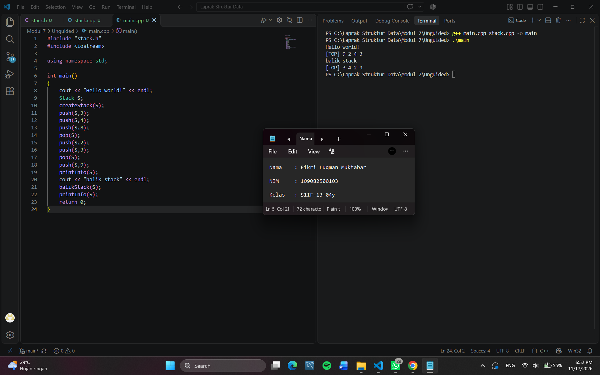
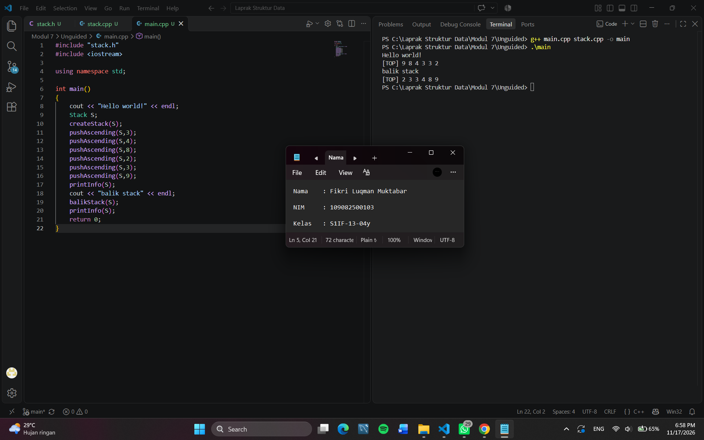
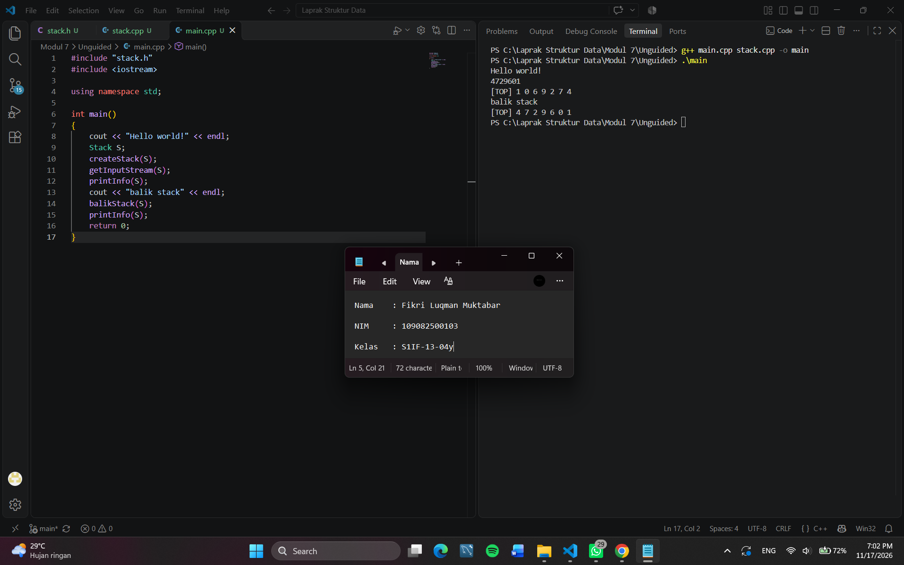

# <h1 align="center">Laporan Praktikum Modul 7 - Stack</h1>

<p align="center">Fikri Luqman Muktabar - 109082500103</p>

## Dasar Teori
Stack adalah salah satu bentuk struktur data linear yang prinsip operasinya seperti tumpukan, yaitu data hanya dapat ditambahkan dan dihapus dari satu sisi, yaitu ujung tumpukan[1]. Seperti tumpukan benda, elemen yang dapat diambil terlebih dahulu adalah elemen yang paling atas, atau elemen yang paling akhir masuk. Prinsip ini disebut LIFO (Last In First Out)[1][2]. Stack dapat diimplementasikan menggunakan array maupun linked list, dan pilihan di antara keduanya bergantung pada kebutuhan fleksibilitas dan efisiensi memori[2].

### A. Konsep Dasar Stack<br/>
Komponen-komponen dalam stack pada dasarnya sama dengan komponen pada singly linked list, hanya saja akses pada stack hanya dapat dilakukan pada awal stack saja. Karena itu, bentuk stack mirip dengan list linear yang terdiri dari elemen-elemen yang saling terkait.

#### 1. Pengertian dan Prinsip LIFO
Stack bekerja dengan prinsip LIFO, yaitu elemen yang terakhir ditambahkan menjadi elemen pertama yang dikeluarkan[2]. Prinsip ini sejalan dengan kebutuhan aplikasi yang harus membatalkan aksi terakhir terlebih dahulu, misalnya fitur undo, karena aksi yang paling baru dilakukan menjadi aksi pertama yang dibatalkan[3].

#### 2. Komponen Stack
Komponen utama yang berfungsi untuk mengakses data dalam stack hanyalah elemen paling awal yang disebut Top. Setiap elemen (elmStack) menyimpan info berupa data dan next berupa alamat elemen di bawahnya, sedangkan stack hanya memiliki satu field, yaitu Top. Stack kosong ditandai dengan Top yang bernilai Nil.

#### 3. Primitif-Primitif Stack
Primitif pada stack pada dasarnya sama dengan primitif pada list lainnya, tetapi jumlahnya lebih sedikit karena operasi hanya dilakukan terhadap elemen paling atas. Primitif tersebut antara lain createStack() untuk membuat stack kosong, isEmpty() untuk memeriksa apakah stack kosong, alokasi() dan dealokasi() untuk mengelola memori elemen, serta fungsi pencarian dan primitif lainnya. Primitif-primitif ini disimpan pada file *.h (deklarasi) dan *.c atau *.cpp (implementasi).

### B. Operasi pada Stack<br/>
Dalam stack terdapat dua operasi utama, yaitu operasi penyisipan (Push) dan operasi pengambilan (Pop)[1]. Pada kedua operasi, hanya elemen Top yang dikenai perubahan. Operasi dasar stack memiliki kompleksitas waktu konstan O(1)[3].

#### 1. Push
Push adalah operasi menyisipkan elemen pada tumpukan data, yaitu menambahkan elemen baru ke posisi teratas stack[1][2]. Operasi ini sama dengan insert first pada list biasa. Pada representasi pointer, prosesnya terdiri dari tiga langkah: membuat elemen baru dengan alokasi(), mengarahkan next elemen baru ke Top yang lama, lalu menjadikan elemen baru sebagai Top yang baru.

#### 2. Pop
Pop adalah operasi pengambilan data dari posisi Top, yaitu menghapus elemen teratas sekaligus mengembalikan nilainya[1][2]. Operasi ini mirip dengan delete first pada list linear. Pada representasi pointer, prosesnya terdiri dari menyimpan Top ke penunjuk sementara P, memindahkan Top ke elemen berikutnya, lalu mengembalikan P.

#### 3. Operasi Tambahan
Selain Push dan Pop, stack dapat dilengkapi operasi lain yang memanfaatkan primitifnya, seperti menampilkan seluruh isi stack dari Top ke dasar, membalik urutan elemen stack, menyisipkan elemen secara terurut (push ascending), dan membaca inputan per karakter untuk dimasukkan ke dalam stack.

### C. Representasi Stack<br/>
Stack dapat direpresentasikan dengan dua cara, yaitu menggunakan pointer dan menggunakan tabel (array)[1].

#### 1. Representasi Pointer
Pada representasi pointer, stack tersusun dari simpul-simpul yang saling terhubung melalui pointer, sehingga ukurannya dapat bertambah dan berkurang secara dinamis[1]. Karena itu, representasi ini memerlukan manajemen memori melalui alokasi() dan dealokasi().

#### 2. Representasi Tabel
Pada representasi tabel, stack disimpan dalam array berukuran tetap pada memori yang berurutan, dan posisi elemen teratas dilacak menggunakan indeks Top[1]. Menurut modul, jumlah tumpukan terbatas hingga Imax, dan stack kosong ditandai dengan Top = 0. Operasi Push dilakukan dengan menaikkan indeks (Top = Top + 1) lalu mengisi data pada indeks tersebut. Operasi Pop dilakukan dengan menyimpan info pada indeks Top (Temp = S.Info[Top]) lalu menurunkan indeks (Top = Top − 1), tanpa menghapus info pada indeks Top sebelumnya. Perbedaan utama dengan representasi pointer ada pada manajemen memori, yaitu representasi tabel tidak memerlukan alokasi dan dealokasi.

## Guided 1 

### stack.h
```C++
#ifndef STACK_TABLE
#define STACK_TABLE
#include <iostream>
using namespace std;

const int MAX = 10;

struct stackTable
{
    int data[MAX];
    int top;
};

bool isEmpty(stackTable s);
bool isFull(stackTable s);
void createStack(stackTable &s);
void push(stackTable &s, int angka);
void pop(stackTable &s);
void update(stackTable &s, int posisi);
void view(stackTable s);
void searchData(stackTable s, int Data);

#endif
```

### Penjelasan Singkat 
stack.h digunakan untuk mendeklarasikan struktur Stack berbasis array yang menyimpan data berupa bilangan bulat. Struktur stackTable memiliki field data berupa array berukuran MAX untuk menyimpan elemen, dan field top sebagai penunjuk elemen paling atas.
#include <iostream> digunakan untuk mendukung input dan output, using namespace std; untuk menggunakan fitur standar C++ tanpa awalan std::, dan const int MAX = 10; untuk menetapkan kapasitas maksimum stack sebanyak 10 elemen. Selain itu, struct digunakan untuk mengelompokkan array data dan top menjadi satu tipe data bernama stackTable.
File ini juga berisi deklarasi fungsi dan prosedur untuk mengecek stack kosong (isEmpty) dan penuh (isFull), membuat stack (createStack), menambah elemen (push), menghapus elemen teratas (pop), mengubah data pada posisi tertentu (update), menampilkan isi stack (view), dan mencari data (searchData). Sementara itu, #ifndef STACK_TABLE, #define STACK_TABLE, dan #endif digunakan sebagai include guard agar deklarasi tidak diproses berulang kali.

### stack.cpp
```C++
#include "stack.h"
#include <iostream>
using namespace std;

bool isEmpty(stackTable s)
{
    return s.top == -1;
}

bool isFull(stackTable s)
{
    return s.top == MAX - 1;
}

void createStack(stackTable &s)
{
    s.top = -1;
}

void push(stackTable &s, int angka)
{
    if (isFull(s))
    {
        cout << "Stack penuh!" << endl;
    }
    else
    {
        s.top++;
        s.data[s.top] = angka;
        cout << "Data " << angka << " berhasil ditambahkan kedalam stack!" << endl;
    }
}

void pop(stackTable &s)
{
    if (isEmpty(s))
    {
        cout << "Stack kosong!" << endl;
    }
    else
    {
        int val = s.data[s.top];
        s.top--;
        cout << "Data " << val << " berhasil dihapus dari stack!" << endl;
    }
}

void update(stackTable &s, int posisi)
{
    if (isEmpty(s))
    {
        cout << "Stack kosong!" << endl;
        return; 
    }
    if (posisi <= 0)
    {
        cout << "Posisi tidak valid!" << endl;
        return;
    }

    int idx = s.top - (posisi - 1);
    if (idx < 0 || idx > s.top)
    {
        cout << "Posisi " << posisi << " tidak valid!" << endl;
        return;
    }

    cout << "Update data posisi ke-" << posisi << endl;
    cout << "Masukkan angka : ";
    cin >> s.data[idx];
    cout << "Data berhasil diupdate!" << endl;
    cout << endl;
}

void view(stackTable s)
{
    if (isEmpty(s))
    {
        cout << "Stack kosong!" << endl;
    }
    else
    {
        for (int i = s.top; i >= 0; --i)
        {
            cout << s.data[i] << " ";
        }
    }
    cout << endl;
}

void searchData(stackTable s, int data)
{
    if (isEmpty(s))
    {
        cout << "Stack kosong!" << endl;
        return;
    }

    cout << "Mencari data " << data << "..." << endl;
    int posisi = 1;
    bool found = false;

    for (int i = s.top; i >= 0; --i)
    {
        if (s.data[i] == data)
        {
            cout << "Data " << data << " ditemukan pada posisi ke-" << posisi << endl;
            cout << endl;
            found = true;
            break;
        }
        posisi++;
    }

    if (!found)
    {
        cout << "Data " << data << " tidak ditemukan didalam stack!" << endl;
        cout << endl;
    }
}
```

### Penjelasan Singkat 
stack.cpp digunakan untuk mengimplementasikan fungsi dan prosedur yang telah dideklarasikan pada file Stack.h. Fungsi isEmpty() dan isFull() digunakan untuk memeriksa kondisi stack, yaitu kosong apabila top bernilai -1 dan penuh apabila top bernilai MAX - 1, sedangkan createStack() digunakan untuk membuat stack kosong dengan mengisi top dengan -1.
Prosedur push() digunakan untuk menambahkan data ke bagian atas stack dengan menaikkan top lalu menyimpan angka pada indeks top, sedangkan pop() digunakan untuk menghapus data teratas dengan mengurangi top. Keduanya menampilkan pesan “Stack penuh!” atau “Stack kosong!” apabila operasinya tidak dapat dilakukan, dan pesan berhasil apabila operasinya sukses. Selain itu, view() digunakan untuk menampilkan seluruh isi stack dari elemen teratas (indeks top) sampai elemen paling bawah (indeks 0).
Prosedur update() digunakan untuk mengubah data pada posisi tertentu, dengan posisi dihitung dari atas stack (posisi 1 adalah elemen teratas) sehingga indeks array dihitung dengan s.top - (posisi - 1). Sebelum data diubah, update() memeriksa apakah stack kosong, apakah posisi kurang dari atau sama dengan 0, dan apakah indeks berada di luar jangkauan, lalu membaca angka baru menggunakan cin. Sementara itu, searchData() digunakan untuk mencari data dengan menelusuri stack dari elemen teratas ke bawah sambil menghitung posisi, lalu menampilkan posisi data apabila ditemukan atau pesan tidak ditemukan apabila tidak ada.

### main.cpp
```C++
#include "stack.h"
#include <iostream>

using namespace std;

int main()
{
    stackTable s;
    createStack(s);

    push(s, 1);
    push(s, 2);
    push(s, 3);
    push(s, 4);
    push(s, 5);
    cout << endl;

    cout << "--- Stack setelah push ---" << endl;
    view(s);
    cout << endl;

    pop(s);
    pop(s);
    cout << endl;

    cout << "--- Stack setelah pop 2 kali ---" << endl;
    view(s);
    cout << endl;

    update(s, 2);
    update(s, 1);
    cout << endl;

    cout << "--- Stack setelah update ---" << endl;
    view(s);
    cout << endl;

    searchData(s, 4);
    searchData(s, 9);

    return 0;
}
```

### Penjelasan Singkat 
main.cpp digunakan untuk menjalankan program utama dengan membuat stack kosong menggunakan createStack(), lalu memasukkan lima angka (1, 2, 3, 4, dan 5) ke dalam stack menggunakan push(). Selanjutnya, view() menampilkan seluruh isi stack dari elemen teratas, sehingga hasilnya 5 4 3 2 1.
Kemudian, pop() dipanggil dua kali untuk menghapus elemen teratas, yaitu 5 lalu 4, sehingga stack menyisakan 3 2 1 yang ditampilkan kembali menggunakan view(). Setelah itu, update() digunakan untuk memperbarui data melalui input, dengan update(s, 2) mengubah elemen posisi ke-2 dari atas (angka 2) dan update(s, 1) mengubah elemen posisi ke-1 atau teratas (angka 3). Hasil perubahannya ditampilkan kembali menggunakan view().
Terakhir, searchData() digunakan untuk mencari angka 4 dan angka 9 di dalam stack, lalu menampilkan posisi data apabila ditemukan atau pesan tidak ditemukan apabila tidak ada. Karena angka 4 sudah dihapus oleh pop() dan angka 9 tidak pernah dimasukkan, hasil pencarian keduanya bergantung pada angka yang dimasukkan saat proses update. Misalnya, jika mengetik 4 saat update, maka angka 4 akan ditemukan, sedangkan jika tidak, program menampilkan “Data 4 tidak ditemukan didalam stack!”.

## Guided 2 

### stack.h
```C++
#ifndef STACK
#define STACK
#define Nil NULL
#include <iostream>
using namespace std;

typedef struct node *address;

struct node
{
    int dataAngka;
    address next;
};

struct stack
{
    address top;
};

bool isEmpty(stack listStack);
void createStack(stack &listStack);
address alokasi (int angka);
void dealokasi(address &node);

void push(stack &listStack, address nodeBaru);
void pop(stack &listStack);
void update(stack &listStack, int posisi);
void view(stack listStack);
void searchData(stack listStack, int data);

#endif
```

### Penjelasan Singkat 
stack.h digunakan untuk mendeklarasikan struktur Stack berbasis Linked List yang menyimpan data berupa bilangan bulat. Struktur node memiliki field dataAngka untuk menyimpan angka dan next untuk menyimpan alamat node di bawahnya, sedangkan struktur stack hanya memiliki field top sebagai penunjuk node paling atas.
#include <iostream> digunakan untuk mendukung input dan output, using namespace std; untuk menggunakan fitur standar C++ tanpa awalan std::, dan #define Nil NULL untuk menyatakan pointer kosong. Selain itu, typedef struct node address; digunakan untuk membuat nama alias address sebagai pengganti node agar penulisan tipe pointer lebih singkat.
File ini juga berisi deklarasi fungsi dan prosedur untuk mengecek stack kosong (isEmpty), membuat stack (createStack), mengelola memori node (alokasi dan dealokasi), menambah node ke bagian atas (push), menghapus node teratas (pop), mengubah data pada posisi tertentu (update), menampilkan isi stack (view), dan mencari data (searchData). Sementara itu, #ifndef STACK, #define STACK, dan #endif digunakan sebagai include guard agar deklarasi tidak diproses berulang kali.
Berbeda dengan versi array sebelumnya, stack ini tidak memiliki batas kapasitas (MAX) sehingga tidak ada fungsi isFull. Prosedur push menerima address nodeBaru, yaitu node yang sudah dialokasikan terlebih dahulu dengan alokasi(), sedangkan createStack, push, pop, dan update menerima stack &listStack (pass by reference) karena mengubah isi stack.

### stack.cpp
```C++
#include "stack.h"
#include <iostream>

using namespace std;

bool isEmpty(stack listStack)
{
    if (listStack.top == Nil)
    {
        return true;
    }
    else
    {
        return false;
    }
}

void createStack(stack &listStack)
{
    listStack.top = Nil;
}

address alokasi(int angka)
{
    address nodeBaru = new node;
    nodeBaru->dataAngka = angka;
    nodeBaru->next = Nil;
    return nodeBaru;
}

void dealokasi(address &node)
{
    node->next = Nil;
    delete node;
}

void push(stack &listStack, address nodeBaru)
{
    nodeBaru->next = listStack.top;
    listStack.top = nodeBaru;
    cout << "Node " << nodeBaru->dataAngka << " berhasil ditambahkan kedalam stack!" << endl;
}

void pop(stack &listStack)
{
    address nodeHapus;
    if (isEmpty(listStack) == true)
    {
        cout << "Stack kosong!" << endl;
    }
    else
    {
        nodeHapus = listStack.top;
        listStack.top = listStack.top->next;
        nodeHapus->next = Nil;
        dealokasi(nodeHapus);
        cout << "node " << nodeHapus->dataAngka << " berhasil dihapus dari stack!" << endl;
    }
}

void update(stack &listStack, int posisi)
{
    if (isEmpty(listStack) == true)
    {
        cout << "Stack kosong!" << endl;
    }
    else
    {
        if (posisi == 0)
        {
            cout << "Posisi tidak valid!" << endl;
        }
        else
        {
            address nodeBantu = listStack.top;
            int count = 1;
            bool found = false;
            while (nodeBantu != Nil)
            {
                if (count < posisi)
                {
                    nodeBantu = nodeBantu->next;
                    count++;
                }
                else if (count == posisi)
                {
                    cout << "Update node poisisi ke-" << posisi << endl;
                    cout << "Masukkan angka : ";
                    cin >> nodeBantu->dataAngka;
                    cout << "Data berhasil diupdate!" << endl;
                    cout << endl;
                    found = true;
                    break;
                }
            }
            if (found == false)
            {
                cout << "Posisi " << posisi << " tidak valid!" << endl;
            }
        }
    }
}

void view(stack listStack)
{
    if (isEmpty(listStack) == true)
    {
        cout << "List kosong!" << endl;
    }
    else
    {
        address nodeBantu = listStack.top;
        while (nodeBantu != Nil)
        {
            cout << nodeBantu->dataAngka << " ";
            nodeBantu = nodeBantu->next;
        }
    }
    cout << endl;
}

void searchData(stack listStack, int data)
{
    if (isEmpty(listStack) == true)
    {
        cout << "List kosong!" << endl;
    }
    else
    {
        address nodeBantu = listStack.top;
        int posisi = 1;
        bool found = false;
        cout << "Mencari data " << data << "..." << endl;
        while (nodeBantu != Nil)
        {
            if (nodeBantu->dataAngka == data)
            {
                cout << "Data " << data << " ditemukan pada posisi ke-" << posisi << endl;
                found = true;
                cout << endl;
                break;
            }
            else
            {
                posisi++;
                nodeBantu = nodeBantu->next;
            }
        }
        if (found == false)
        {
            cout << "Data " << data << " tidak ditemukan didalam stack!" << endl;
            cout << endl;
        }
    }
}
```

### Penjelasan Singkat 
stack.cpp digunakan untuk mengimplementasikan fungsi dan prosedur yang telah dideklarasikan pada file Stack.h. Fungsi isEmpty() dan createStack() digunakan untuk memeriksa dan membuat stack kosong dengan mengisi top dengan Nil, sedangkan alokasi() dan dealokasi() digunakan untuk membuat node baru berisi angka dengan next bernilai Nil serta menghapus node dari memori menggunakan new dan delete.
Prosedur push() digunakan untuk menambahkan node ke bagian atas stack dengan mengarahkan next node baru ke top yang lama, lalu menjadikan node baru sebagai top. Sementara itu, pop() digunakan untuk menghapus node teratas dengan menyimpan top ke nodeHapus, memindahkan top ke node di bawahnya, memutus next nodeHapus, lalu menghapusnya dengan dealokasi(). Selain itu, view() digunakan untuk menampilkan seluruh data dari node teratas sampai node terakhir dengan menelusuri pointer next, dan menampilkan pesan “List kosong!” apabila stack kosong.
Prosedur update() digunakan untuk mengubah data pada posisi tertentu, dengan posisi dihitung dari top (posisi 1 adalah node teratas). Prosedur ini menelusuri node menggunakan nodeBantu dan variabel count sampai count sama dengan posisi, lalu membaca angka baru dari keyboard menggunakan cin. Apabila stack kosong, posisi bernilai 0, atau posisi melebihi jumlah node, program menampilkan pesan tidak valid. Terakhir, searchData() digunakan untuk mencari data dengan menelusuri stack dari top sambil menghitung posisi, lalu menampilkan posisi data apabila ditemukan atau pesan tidak ditemukan apabila sampai akhir stack data tidak ada.

### main.cpp
```C++
#include "stack.h"
#include <iostream>

using namespace std;

int main()
{
    stack listStack;
    address nodeA, nodeB, nodeC, nodeD, nodeE = Nil;
    createStack(listStack);

    nodeA = alokasi(1);
    nodeB = alokasi(2);
    nodeC = alokasi(3);
    nodeD = alokasi(4);
    nodeE = alokasi(5);

    push(listStack, nodeA);
    push(listStack, nodeB);
    push(listStack, nodeC);
    push(listStack, nodeD);
    push(listStack, nodeE);
    cout << endl;

    cout << "--- Stack setelah push ---" << endl;
    view(listStack);
    cout << endl;

    pop(listStack);
    pop(listStack);
    cout << endl;

    cout << "--- Stack setelah pop 2 kali ---" << endl;
    view(listStack);
    cout << endl;

    update(listStack, 2);
    update(listStack, 1);
    update(listStack, 4);
    cout << endl;

    cout << "--- Stack setelah update ---" << endl;
    view(listStack);
    cout << endl;

    searchData(listStack, 4);
    searchData(listStack, 9);

    return 0;
}
```

### Penjelasan Singkat 
main.cpp digunakan untuk menjalankan program utama dengan membuat stack kosong menggunakan createStack() dan mengalokasikan lima node berisi angka 1, 2, 3, 4, dan 5 menggunakan alokasi(). Prosedur push() digunakan untuk memasukkan kelima node tersebut ke bagian atas stack secara berurutan. Selanjutnya, view() menampilkan seluruh isi stack dari node teratas, sehingga hasilnya 5 4 3 2 1.
Kemudian, pop() dipanggil dua kali untuk menghapus node teratas, yaitu 5 lalu 4, sehingga stack menyisakan 3 2 1 yang ditampilkan kembali menggunakan view(). Setelah itu, update() digunakan untuk memperbarui data melalui input, dengan update(listStack, 2) mengubah node posisi ke-2 dari atas (angka 2), update(listStack, 1) mengubah node teratas (angka 3), dan update(listStack, 4) mencoba mengubah posisi ke-4. Karena stack hanya memiliki tiga node, update posisi ke-4 tidak diproses dan program menampilkan pesan “Posisi 4 tidak valid!” tanpa meminta input. Hasil perubahan ditampilkan kembali menggunakan view().
Terakhir, searchData() digunakan untuk mencari angka 4 dan angka 9 di dalam stack, lalu menampilkan posisi data apabila ditemukan atau pesan tidak ditemukan apabila tidak ada. Karena angka 4 sudah dihapus oleh pop() dan angka 9 tidak pernah dimasukkan, hasil pencarian keduanya bergantung pada angka yang dimasukkan saat proses update. Misalnya, jika mengetik 4 saat update, maka angka 4 akan ditemukan, sedangkan jika tidak, program menampilkan “Data 4 tidak ditemukan di dalam stack!”.

## Unguided

### Buatlah ADT Stack menggunakan ARRAY di dalam file “stack.h”. Kemudian buat implementasi ADT Stack menggunakan Array pada file “stack.cpp” dan “main.cpp”. Lalu tambahkan prosedur pushAscending dan getInputStream.

### stack.h
```C++
#ifndef STACK_H
#define STACK_H

#include <iostream>
using namespace std;

typedef int infotype;

struct Stack {
    infotype info[20];
    int Top;
};

void createStack(Stack &S);
bool isEmpty(Stack S);
void push(Stack &S, infotype x);
infotype pop(Stack &S);
void printInfo(Stack S);
void balikStack(Stack &S);
void pushAscending(Stack &S, infotype x);
void getInputStream(Stack &S);

#endif
```

### stack.cpp
```C++
#include "stack.h"
#include <iostream>

using namespace std;

void createStack(Stack &S) {
    S.Top = 0;
}

bool isEmpty(Stack S) {
    return S.Top == 0;
}

void push(Stack &S, infotype x) {
    S.Top = S.Top + 1;
    S.info[S.Top] = x;
}

infotype pop(Stack &S) {
    infotype x = S.info[S.Top];
    S.Top = S.Top - 1;
    return x;
}

void printInfo(Stack S) {
    cout << "[TOP]";
    for (int i = S.Top; i >= 1; i--) {
        cout << " " << S.info[i];
    }
    cout << endl;
}

void balikStack(Stack &S) {
    Stack T;
    createStack(T);
    while (!isEmpty(S)) {
        push(T, pop(S));
    }
    S = T;
}

void pushAscending(Stack &S, infotype x) {
    Stack T;
    createStack(T);
    while (!isEmpty(S) && S.info[S.Top] > x) {
        push(T, pop(S));
    }
    push(S, x);
    while (!isEmpty(T)) {
        push(S, pop(T));
    }
}

void getInputStream(Stack &S) {
    char c = cin.get();
    while (c != '\n') {
        push(S, c - '0');
        c = cin.get();
    }
}
```

### main.cpp
```C++
#include "stack.h"
#include <iostream>

using namespace std;

int main()
{
    Stack S;

    cout << "Hello world!" << endl;
    createStack(S);
    push(S,3);
    push(S,4);
    push(S,8);
    pop(S);
    push(S,2);
    push(S,3);
    pop(S);
    push(S,9);
    printInfo(S);
    cout << "balik stack" << endl;
    balikStack(S);
    printInfo(S);

    cout << endl;

    cout << "Hello world!" << endl;
    createStack(S);
    pushAscending(S,3);
    pushAscending(S,4);
    pushAscending(S,8);
    pushAscending(S,2);
    pushAscending(S,3);
    pushAscending(S,9);
    printInfo(S);
    cout << "balik stack" << endl;
    balikStack(S);
    printInfo(S);

    cout << endl;

    cout << "Hello world!" << endl;
    createStack(S);
    getInputStream(S);
    printInfo(S);
    cout << "balik stack" << endl;
    balikStack(S);
    printInfo(S);

    return 0;
}
```

### Output Unguided :

##### Output 1

 

##### Output 2

 

##### Output 3

 

### Penjelasan Unguided 
stack.h digunakan untuk menyimpan deklarasi struktur data Stack berbasis array yang memiliki field info berupa array berukuran 20 untuk menyimpan data bertipe infotype (integer), serta field Top untuk menunjukkan indeks elemen teratas, dengan Top bernilai 0 menandakan stack kosong. File ini juga berisi guard #ifndef STACK_H agar header tidak terbaca dua kali, #include <iostream> dan using namespace std;, serta deklarasi prosedur dan fungsi untuk membuat stack kosong, mengecek apakah stack kosong, memasukkan dan mengambil elemen, menampilkan isi stack, membalik urutan stack, memasukkan elemen secara terurut menaik, dan membaca input angka dari keyboard.

Kemudian, stack.cpp digunakan untuk menuliskan implementasi fungsi dan prosedur yang telah dideklarasikan pada file stack.h. createStack digunakan untuk membuat stack kosong dengan mengisi Top dengan 0, isEmpty digunakan untuk mengecek apakah Top bernilai 0, push digunakan untuk menambah Top lalu menyimpan data baru pada indeks Top, sedangkan pop digunakan untuk mengambil data pada indeks Top kemudian mengurangi Top. Selain itu, printInfo digunakan untuk menampilkan isi stack mulai dari elemen paling atas (Top) sampai elemen paling bawah dengan diawali tulisan [TOP]. balikStack digunakan untuk membalik urutan stack dengan memindahkan seluruh elemen dari stack S ke stack bantu T menggunakan pop dan push, lalu menyalin hasilnya kembali ke S. pushAscending digunakan untuk menyisipkan elemen agar stack tetap terurut menaik dari dasar ke Top, yaitu dengan memindahkan sementara elemen yang lebih besar dari x ke stack bantu T, memasukkan x, kemudian mengembalikan elemen dari T ke S. Terakhir, getInputStream digunakan untuk membaca input per karakter menggunakan cin.get() sampai pengguna menekan enter, dan setiap karakter diubah menjadi angka dengan c - '0' sebelum dimasukkan ke stack.

Lalu, main.cpp digunakan untuk menjalankan program utama dengan membuat satu variabel Stack S yang dipakai untuk tiga pengujian secara berurutan, dan setiap pengujian diawali dengan createStack agar stack kosong kembali. Pada pengujian pertama, program melakukan push angka 3, 4, dan 8, pop satu kali, push angka 2 dan 3, pop satu kali, lalu push angka 9, kemudian menampilkan isi stack dengan printInfo, membaliknya dengan balikStack, dan menampilkannya lagi. Pada pengujian kedua, program memasukkan angka 3, 4, 8, 2, 3, dan 9 menggunakan pushAscending sehingga elemen otomatis tersusun terurut, lalu menampilkan stack sebelum dan sesudah dibalik. Pada pengujian ketiga, program meminta input deretan angka menggunakan getInputStream, kemudian menampilkan isi stack sebelum dan sesudah dibalik.

Secara keseluruhan, program ini digunakan untuk mempelajari penerapan struktur data Stack dengan prinsip LIFO (Last In First Out), mulai dari membuat stack, menambah dan mengambil elemen dari bagian atas, menampilkan isi stack, membalik stack, hingga menyisipkan elemen secara terurut. Karena elemen terakhir yang masuk berada di Top dan data ditampilkan dari Top ke bawah, hasil pada pengujian pertama adalah 9 2 4 3 dan setelah dibalik menjadi 3 4 2 9. Pada pengujian kedua, karena stack terurut menaik dari dasar ke Top, hasilnya 9 8 4 3 3 2 dan setelah dibalik menjadi 2 3 3 4 8 9. Pada pengujian ketiga, apabila menginputkan 4729601, hasilnya 1 0 6 9 2 7 4 dan setelah dibalik menjadi 4 7 2 9 6 0 1.

## Kesimpulan 
Berdasarkan praktikum yang telah dilakukan, dapat disimpulkan bahwa Stack merupakan struktur data linear yang menerapkan prinsip LIFO (Last In First Out), yaitu elemen yang terakhir dimasukkan menjadi elemen pertama yang dikeluarkan, dengan akses data yang hanya dilakukan pada satu sisi melalui penunjuk Top. Pada praktikum ini, dipelajari cara membuat stack kosong, mengecek kondisi stack kosong dan penuh, menambahkan elemen menggunakan push, menghapus elemen teratas menggunakan pop, menampilkan isi stack, memperbarui data pada posisi tertentu, serta mencari data dalam stack. Selain itu, stack diimplementasikan dengan dua representasi, yaitu representasi tabel (array) yang berukuran tetap dengan indeks Top, serta representasi pointer (linked list) yang bersifat dinamis dan memerlukan alokasi dan dealokasi memori pada setiap node. Pada bagian unguided, ADT Stack berbasis array dilengkapi dengan prosedur balikStack untuk membalik urutan stack menggunakan stack bantu, pushAscending untuk menyisipkan elemen agar stack tetap terurut menaik dari dasar ke Top, dan getInputStream untuk membaca input per karakter menggunakan cin.get(). Dari hasil program, diperoleh urutan data 9 2 4 3 yang berubah menjadi 3 4 2 9 setelah dibalik pada output pertama, urutan 9 8 4 3 3 2 yang berubah menjadi 2 3 3 4 8 9 pada output kedua, serta urutan 1 0 6 9 2 7 4 yang berubah menjadi 4 7 2 9 6 0 1 pada output ketiga dengan input 4729601.

## Referensi
[1] Setiyawan, Risky Dwi., Hermawan, Doni., Abdillah, Ahmad Fahmi., Mujayanah, Arsil., Vindua, Raditia. (2024). "Penggunaan Struktur Data Stack dalam Pemrograman C++ dengan Pendekatan Array dan Linked List". 5(2), 484–498. Diakses pada 17 November 2026 melalui https://jurnal.stkippersada.ac.id/jurnal/index.php/jutech/article/download/4263/pdf.
<br>[2] Amaylia, Sarah., Setiabudi, Viktoria Angelita., Alvianino, Renza., Saputra, Rahmat Nugroho., Wardhani, Helena Kusuma., Suroni, Aziz. "Application of Stack Data Structure in Application Development". Surabaya: Universitas Negeri Surabaya. Diakses pada 17 November 2026 melalui https://journal.unesa.ac.id/index.php/jasic/article/download/44459/14049/145706.
<br>[3] Ramadhan, Rifqi Atha., Ikasari, Ines Heidiani. (2026). "Penerapan Struktur Data Stack untuk Implementasi Fitur Undo pada Aplikasi Sederhana: Literature Review". Journal of Computer Science and Information Technology (JCSIT), 3(3), 163–170. Diakses pada 17 November 2026 melalui https://doi.org/10.70248/jcsit.v3i3.3955.