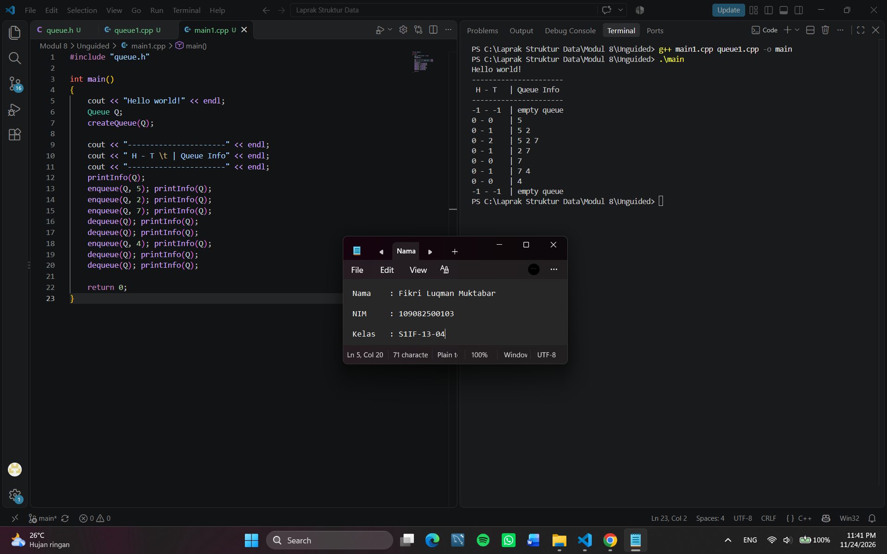
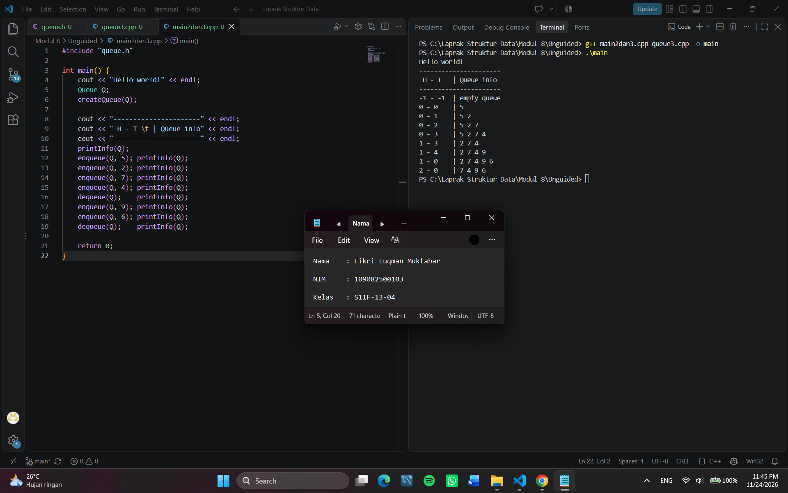

# <h1 align="center">Laporan Praktikum Modul 8 - Queue</h1>

<p align="center">Fikri Luqman Muktabar - 109082500103</p>

## Dasar Teori
Queue merupakan salah satu struktur data yang menggunakan prinsip FIFO (First In First Out), yaitu data yang pertama kali masuk akan menjadi data yang pertama kali keluar. Queue dapat diibaratkan seperti antrean pembelian tiket, ketika orang yang datang lebih dahulu akan mendapatkan pelayanan lebih dahulu. Dalam penerapannya, queue dapat menggunakan array maupun linked list sebagai tempat penyimpanan data [1].

### A. Pengertian dan Operasi Queue<br/>
Queue merupakan struktur data yang memiliki dua bagian utama, yaitu Head dan Tail. Head menunjukkan posisi data paling depan yang akan dikeluarkan, sedangkan Tail menunjukkan posisi data paling belakang tempat data baru ditambahkan. Prinsip FIFO membuat proses penambahan dan penghapusan data dilakukan secara berurutan [1].

#### 1. Enqueue
Enqueue merupakan operasi untuk menambahkan data baru ke dalam queue. Proses penambahan dilakukan pada bagian belakang atau Tail. Jika queue masih kosong, posisi Head dan Tail akan diatur terlebih dahulu sebelum data dimasukkan.

#### 2. Dequeue
Dequeue merupakan operasi untuk menghapus atau mengambil data dari queue. Proses penghapusan dilakukan pada bagian depan atau Head, sehingga data yang pertama kali dimasukkan akan menjadi data pertama yang dikeluarkan.

#### 3. Pengecekan Queue
Pengecekan queue dilakukan untuk mengetahui kondisi antrean sebelum operasi dijalankan. isEmpty digunakan untuk memeriksa apakah queue kosong, sedangkan isFull digunakan untuk memeriksa apakah kapasitas queue sudah penuh. Selain itu, operasi penampilan data digunakan untuk melihat seluruh elemen yang tersimpan dalam queue [2].

### B. Representasi Queue Menggunakan Array<br/>
Queue dengan representasi array merupakan struktur data antrean yang menggunakan tabel atau array sebagai tempat penyimpanan elemen. Berbeda dengan representasi pointer, jumlah elemen pada representasi array memiliki kapasitas terbatas dan tidak memerlukan pengelolaan memori secara dinamis. Pada representasi array, terdapat tiga alternatif mekanisme pengelolaan queue.

#### 1. Alternatif 1 (Head Diam, Tail Bergerak)
Pada alternatif pertama, posisi Head tetap berada di awal array, sedangkan Tail bergerak mengikuti penambahan data. Ketika data dihapus, elemen-elemen setelah Head digeser satu posisi ke depan dan Tail dikurangi. Cara ini cukup sederhana, tetapi proses penghapusan menjadi kurang efisien karena perlu menggeser elemen.

#### 2. Alternatif 2 (Head Bergerak, Tail Bergerak)
Pada alternatif kedua, Head dan Tail sama-sama bergerak sesuai operasi penambahan dan penghapusan data. Ketika data dihapus, Head akan maju ke posisi berikutnya tanpa perlu menggeser elemen lainnya. Cara ini lebih efisien, tetapi dapat menyebabkan kondisi queue penuh semu ketika Tail sudah mencapai batas akhir array meskipun masih terdapat ruang kosong di bagian depan.

#### 3. Alternatif 3 (Head dan Tail Berputar)
Pada alternatif ketiga, Head dan Tail bergerak secara melingkar dari awal hingga akhir array, kemudian kembali ke posisi awal jika sudah mencapai batas maksimal. Representasi ini disebut Circular Queue atau Circular Buffer. Cara ini lebih efisien karena dapat memanfaatkan kembali ruang kosong tanpa harus menggeser elemen [2].

## Guided 1 

### queue.h
```C++
#ifndef QUEUE_H
#define QUEUE_H

#include<iostream>
#include<string>
using namespace std;

struct Node
{
    string nama;
    Node *next;
};

struct queue
{
    Node *head, *tail;
};

void CreateQueue (queue &Q);
bool isEmpty(queue Q);
bool isFull(queue Q);
void enQueue (queue &Q, const string &nama);
void deQueue(queue &Q);
void viewQueue(queue Q);
void clearQueue(queue &Q);
#endif
```

### Penjelasan Singkat 
queue.h digunakan untuk mendeklarasikan struktur data Queue berbasis linked list. Struktur Node memiliki field nama untuk menyimpan data bertipe string dan next untuk menyimpan alamat node berikutnya, sedangkan struktur queue memiliki field head sebagai penunjuk elemen paling depan dan tail sebagai penunjuk elemen paling belakang.
File ini juga berisi deklarasi prosedur dan fungsi yang akan diimplementasikan. CreateQueue() digunakan untuk membuat queue kosong, sedangkan isEmpty() dan isFull() digunakan untuk memeriksa kondisi queue. Prosedur enQueue() digunakan untuk menambahkan data di belakang queue, deQueue() untuk menghapus data di depan queue, viewQueue() untuk menampilkan seluruh isi queue, dan clearQueue() untuk menghapus semua elemen dari queue.

### queue.cpp
```C++
#include "queue.h"

void CreateQueue(queue &Q)
{
    Q.head = Q.tail = nullptr;
}

bool isEmpty(queue Q)
{
    return Q.head == nullptr && Q.tail == nullptr;
}

bool isFull(queue Q)
{
    int maxQueue = 20;
    int counter = 0;
    Node *nodeBantu = Q.head;
    while (nodeBantu != Q.tail)
    {
        counter++;
        nodeBantu = nodeBantu->next;
    }
    return counter >= maxQueue;
}

void enQueue(queue &Q, const string &nama)
{
    if (isEmpty(Q))
    {
        Node *nodeBaru = new Node{nama, nullptr};
        Q.head = Q.tail= nodeBaru;
    } else
    {
        Node *nodeBaru = new Node{nama, nullptr};
        Q.tail->next = nodeBaru;
        Q.tail = nodeBaru;
    }
}

void deQueue (queue &Q){
    if (isEmpty(Q))
    { 
        cout<<"Queue kosong";
    } else
    {
        Node *nodehapus = Q.head;
        Q.head = Q.head -> next;
        delete nodehapus;
    }
}

void viewQueue (queue Q)
{
    if (isEmpty(Q))
    {
        cout<<"Queue Kosong";
    } else
    {
        Node *nodeBantu = Q.head;
        while (nodeBantu != nullptr)
        {
            cout<<"Nama: " <<nodeBantu-> nama;
            nodeBantu = nodeBantu ->next;
        }
    }
}

void clearQueue(queue &Q){
    if (isEmpty(Q))
    {
        cout<<"Queue Kosong";
    } else
    {
        Node *nodehapus = Q.head;
        while (nodehapus != nullptr)
        {
            nodehapus = nodehapus -> next;
            deQueue(Q);
        }
    }
}
```

### Penjelasan Singkat 
queue.cpp digunakan untuk mengimplementasikan fungsi dan prosedur yang telah dideklarasikan pada file queue.h. CreateQueue() digunakan untuk membuat queue kosong dengan mengisi head dan tail dengan nullptr, sedangkan isEmpty() digunakan untuk memeriksa apakah queue kosong, dan isFull() digunakan untuk memeriksa apakah jumlah elemen sudah mencapai batas maksimal 20 dengan menghitung node dari head sampai tail. Prosedur enQueue() digunakan untuk membuat node baru dan menambahkannya di belakang queue. Jika queue masih kosong, head dan tail menunjuk ke node baru, sedangkan jika sudah ada isi, next dari tail diarahkan ke node baru lalu tail dipindahkan. Prosedur deQueue() digunakan untuk menghapus node paling depan dengan memajukan head lalu menghapus node lama dari memori, dan akan menampilkan pesan jika queue kosong. Selain itu, viewQueue() digunakan untuk menampilkan seluruh nama dari head hingga akhir, dan clearQueue() digunakan untuk menghapus semua elemen dengan memanggil deQueue() berulang kali.

### main.cpp
```C++
#include "queue.h"
#include <iostream>
using namespace std;

int main()
{
    queue Q;
    CreateQueue(Q);

    enQueue(Q, "Gilar ");
    enQueue(Q, "Aflah ");
    enQueue(Q, "Aedil ");
    enQueue(Q, "Fathir ");
    enQueue(Q, "Kevin ");
    enQueue(Q, "Zulfa ");
    cout << endl;

    cout << "--- Isi Queue Setelah enQueue ---" << endl;
    viewQueue(Q);        

    deQueue(Q);
    deQueue(Q);
    deQueue(Q);
    deQueue(Q);
    cout << endl;

    cout << "--- Isi Queue Setelah deQueue ---" << endl;
    viewQueue(Q);

    clearQueue(Q);
    return 0;
}
```

### Penjelasan Singkat 
main.cpp digunakan untuk menjalankan program utama, dimulai dengan membuat queue kosong menggunakan CreateQueue(). Kemudian enam nama, yaitu Gilar, Aflah, Aedil, Fathir, Kevin, dan Zulfa, dimasukkan ke bagian belakang queue menggunakan enQueue(), lalu isi queue ditampilkan dengan viewQueue().
Setelah itu, program menghapus empat elemen paling depan menggunakan deQueue() sebanyak empat kali, sehingga yang tersisa hanya Kevin dan Zulfa, lalu menampilkan kembali isi queue dengan viewQueue(). Terakhir, clearQueue() dipanggil untuk menghapus semua elemen yang tersisa dan membebaskan memorinya.

## Guided 2 

### queue.h
```C++
#ifndef QUEUE_H
#define QUEUE_H

#include <iostream>
#include <string>
using namespace std;

const int MAKSIMAL = 5;

struct queue
{
    string nama[MAKSIMAL];
    int head;
    int tail;
};

bool isFull(queue Q);
bool isEmpty(queue Q);
void CreateQueue(queue &Q);
void enQueue(queue &Q, string nama);
void deQueue(queue &Q);
void viewQueue(queue Q);
void clearQueue(queue &Q);

#endif
```

### Penjelasan Singkat 
queue.h digunakan untuk mendeklarasikan struktur data dan fungsi yang diperlukan dalam pengelolaan queue. Struktur queue menyimpan data nama, posisi head, dan tail dengan kapasitas maksimal 5 data. Fungsi isFull() dan isEmpty() digunakan untuk memeriksa kondisi queue, sedangkan CreateQueue() digunakan untuk membuat queue kosong. Prosedur enQueue() dan deQueue() digunakan untuk menambahkan dan menghapus data dari queue. Sementara itu, viewQueue() digunakan untuk menampilkan seluruh data dan clearQueue() digunakan untuk mengosongkan queue.

### queue.cpp
```C++
#include "queue.h"
#include <iostream>

using namespace std;

// NOTE : 
// Implementasi 1 = head diam, tail bergerak (Queue Linear Statis, kerana head nya tetap diam)
// Implementasi 2 = head bergerak, tail bergerak (Queue Linear Dinamis, karena head & tail nya sama-sama bergerak)
// Implementasi 3 = head dan tail berputar (Queue Circular, karena jika udh mentok tapi masih ada space, diputar sehingga tail bisa ada didepan head)

bool isEmpty(queue Q){
    if(Q.head == -1 && Q.tail == -1){
        return true;
    } else {
        return false;
    }
}

//isFull implmenetasi 1 & 2
bool isFull(queue Q){
    if(Q.tail == MAKSIMAL - 1){
        return true;
    } else {
        return false;
    }
}

// //isFull implementasi 3
// bool isFull(queue Q){
//     if((Q.tail + 1) % MAKSIMAL == Q.head){
//         return true;
//     } else {
//         return false;
//     }
// }

void CreateQueue(queue &Q){ //terbentuk queue dengan head = -1 dan tail = -1 
    Q.head = -1;
    Q.tail = -1;
}
 

//enqueue implementasi 1 & 2
void enQueue(queue &Q, string nama){
    if(isFull(Q) == true){
        cout << "Queue sudah penuh!" << endl;
    } else {
        if(isEmpty(Q) == true){
            Q.head = Q.tail = 0;
        } else {
            Q.tail++;
        }
        Q.nama[Q.tail] = nama;
        cout << "nama " << nama << " berhasil ditambahkan kedalam queue!" << endl;
    }
}

// //enQueue implementasi 3
// void enQueue(queue &Q, string nama){
//     if(isFull(Q) == true){
//         cout << "Queue sudah penuh!" << endl;
//     } else {
//         if(isEmpty(Q) == true){
//             Q.head = Q.tail = 0;
//         } else {
//             Q.tail = (Q.tail + 1) % MAKSIMAL; // bergerak melingkar
//         }
//         Q.nama[Q.tail] = nama;
//         cout << "nama " << nama << " berhasil ditambahkan kedalam queue!" << endl;
//     }
// }

//dequeue implementasi 1
void deQueue(queue &Q){
    if(isEmpty(Q) == true){
        cout << "Queue kosong!" << endl;
    } else {
        cout << "Mengahapus data " << Q.nama[Q.head] << "..." << endl;
        for(int i = 0; i < Q.tail; i++){
            Q.nama[i] =  Q.nama[i+1];
        }
        Q.tail--;
        if(Q.tail < 0){ //kalo semua isi queue nya udh dikeluarin, set head & tail ke -1
            Q.head = -1;
            Q.tail = -1;
        }
    }
}

// //dequeue implementasi 2
// void deQueue(queue &Q){
//     if(isEmpty(Q) == true){
//         cout << "Queue kosong!" << endl;
//     } else {
//         cout << "Mengahapus data " << Q.nama[Q.head] << "..." << endl;
//         Q.head++;
//         if(Q.head > Q.tail){ //kalo elemennya udh abis (head akan lebih 1 dari tail), maka reset ulang head & tail ke -1
//             Q.head = -1;
//             Q.tail = -1;
//         }
//     }
// }

// //deQueue implementasi 3
// void deQueue(queue &Q){
//     if(isEmpty(Q) == true){
//         cout << "Queue kosong!" << endl;
//     } else {
//         cout << "Mengahapus data " << Q.nama[Q.head] << "..." << endl;
//         if(Q.head == Q.tail){ //kalo elemennya tinggal 1, langsungkan saja head & tail nya reset ke -1
//             Q.head = -1;
//             Q.tail = -1;
//         } else {
//             Q.head = (Q.head + 1) % MAKSIMAL; // bergerak melingkar
//         }
//     }
// }

//viewQueue implementasi 1 & 2
void viewQueue(queue Q){
    if(isEmpty(Q) == true){
        cout << "Queue kosong!" << endl;
    } else {
        for(int i = Q.head; i <= Q.tail; i++){
            cout << i -  Q.head + 1 << ". " << Q.nama[i] << endl;
        }
    }
    cout << endl;
}

// //viewQueue implementasi 3
// void viewQueue(queue Q){
//     if(isEmpty(Q) == true){
//         cout << "Queue kosong!" << endl;
//     } else {
//         int i = Q.head;
//         int count = 1;
//         while(true){
//             cout << count << ". " << Q.nama[i] << endl;
//             if(i == Q.tail){
//                 break;
//             }
//             i = (i + 1) % MAKSIMAL;
//             count++;
//         }   
//     }
// }
```

### Penjelasan Singkat 
queue.cpp digunakan untuk mengimplementasikan fungsi dan prosedur yang telah dideklarasikan pada file queue.h. Fungsi isEmpty() dan isFull() digunakan untuk memeriksa kondisi queue, sedangkan CreateQueue() digunakan untuk membuat queue kosong. Prosedur enQueue() dan deQueue() digunakan untuk menambahkan dan menghapus data menggunakan implementasi queue linear. Sementara itu, viewQueue() digunakan untuk menampilkan seluruh data yang tersimpan dalam queue.

### main.cpp
```C++
#include "queue.h"
#include <iostream>

using namespace std;

int main()
{
    queue Q;

    CreateQueue(Q);
    enQueue(Q, "Dimas");
    enQueue(Q, "Arvin");
    enQueue(Q, "Rizal");
    enQueue(Q, "Hafizh");
    enQueue(Q, "Fathur");
    enQueue(Q, "Daffa");
    cout << endl;

    cout << "--- Isi Queue Setelah enQueue ---" << endl;
    viewQueue(Q);
    cout << endl;

    deQueue(Q);
    deQueue(Q);
    deQueue(Q);
    deQueue(Q);
    // deQueue(Q);
    // deQueue(Q);
    cout << endl;

    cout << "--- Isi Queue Setelah deQueue ---" << endl;
    viewQueue(Q);

    return 0;
}
```

### Penjelasan Singkat 
main.cpp digunakan untuk menjalankan dan menguji fungsi serta prosedur queue. Program diawali dengan membuat queue kosong, kemudian menambahkan beberapa nama menggunakan enQueue(). Selanjutnya, viewQueue() digunakan untuk menampilkan isi queue, sedangkan deQueue() digunakan untuk menghapus beberapa data. Terakhir, viewQueue() kembali dipanggil untuk menampilkan isi queue setelah penghapusan.

## Unguided

### Buatlah ADT Queue menggunakan ARRAY di dalam file “queue.h”. Kemudian buat implementasinya pada file “queue.cpp” dengan menerapkan mekanisme queue Alternatif 1 (head diam, tail bergerak), Alternatif 2 (head bergerak, tail bergerak), dan Alternatif 3 (head dan tail berputar).

### queue.h
```C++
#ifndef QUEUE_H
#define QUEUE_H

#include <iostream>
using namespace std;

typedef int infotype;

const int MAX = 5;

struct Queue {
    infotype info[MAX]; 
    int head, tail;
};

void createQueue(Queue &Q);
bool isEmptyQueue(Queue Q);
bool isFullQueue(Queue Q);
void enqueue(Queue &Q, infotype x);
infotype dequeue(Queue &Q);
void printInfo(Queue Q);

#endif
```

### queue1.cpp
```C++
#include "queue.h"

void createQueue(Queue &Q) {
    Q.head = -1;
    Q.tail = -1;
}

bool isEmptyQueue(Queue Q) {
    return Q.head == -1 && Q.tail == -1;
}

bool isFullQueue(Queue Q) {
    return Q.tail == MAX - 1;
}

void enqueue(Queue &Q, infotype x) {
    if (isFullQueue(Q)) {
        cout << "Queue penuh" << endl;
    } else {
        if (isEmptyQueue(Q)) {
            Q.head = 0;          
            Q.tail = 0;
        } else {
            Q.tail++;           
        }
        Q.info[Q.tail] = x;
    }
}

infotype dequeue(Queue &Q) {
    if (isEmptyQueue(Q)) {
        cout << "Queue kosong" << endl;
        return -1;
    }
    infotype x = Q.info[Q.head];
    if (Q.head == Q.tail) {     
        Q.head = -1;
        Q.tail = -1;
    } else {
        for (int i = Q.head; i < Q.tail; i++) {   
            Q.info[i] = Q.info[i + 1];
        }
        Q.tail--;              
    }
    return x;
}

void printInfo(Queue Q) {
    cout << Q.head << " - " << Q.tail << "\t | ";
    if (isEmptyQueue(Q)) {
        cout << "empty queue";
    } else {
        for (int i = Q.head; i <= Q.tail; i++) {
            cout << Q.info[i] << " ";
        }
    }
    cout << endl;
}
```

### queue2.cpp
```C++
#include "queue.h"

void createQueue(Queue &Q) {
    Q.head = -1;
    Q.tail = -1;
}

bool isEmptyQueue(Queue Q) {
    return Q.head == -1 && Q.tail == -1;
}

bool isFullQueue(Queue Q) {
    return Q.head == 0 && Q.tail == MAX - 1;
}

void enqueue(Queue &Q, infotype x) {
    if (isFullQueue(Q)) {
        cout << "Queue penuh" << endl;
    } else {
        if (isEmptyQueue(Q)) {
            Q.head = 0;          
            Q.tail = 0;
        } else {
            if (Q.tail == MAX - 1) {
                int n = Q.tail - Q.head + 1;
                for (int i = 0; i < n; i++) {
                    Q.info[i] = Q.info[Q.head + i];
                }
                Q.head = 0;
                Q.tail = n - 1;
            }
            Q.tail++;            
        }
        Q.info[Q.tail] = x;
    }
}

infotype dequeue(Queue &Q) {
    if (isEmptyQueue(Q)) {
        cout << "Queue kosong" << endl;
        return -1;
    }
    infotype x = Q.info[Q.head];
    if (Q.head == Q.tail) {      
        Q.head = -1;
        Q.tail = -1;
    } else {
        Q.head++;               
    }
    return x;
}

void printInfo(Queue Q) {
    cout << Q.head << " - " << Q.tail << "\t | ";
    if (isEmptyQueue(Q)) {
        cout << "empty queue";
    } else {
        for (int i = Q.head; i <= Q.tail; i++) {
            cout << Q.info[i] << " ";
        }
    }
    cout << endl;
}
```

### queue3.cpp
```C++
#include "queue.h"

void createQueue(Queue &Q) {
    Q.head = -1;
    Q.tail = -1;
}

bool isEmptyQueue(Queue Q) {
    return Q.head == -1 && Q.tail == -1;
}

bool isFullQueue(Queue Q) {
    return !isEmptyQueue(Q) && (Q.tail + 1) % MAX == Q.head;
}

void enqueue(Queue &Q, infotype x) {
    if (isFullQueue(Q)) {
        cout << "Queue penuh" << endl;
    } else {
        if (isEmptyQueue(Q)) {
            Q.head = 0;         
            Q.tail = 0;
        } else {
            Q.tail = (Q.tail + 1) % MAX;   
        }
        Q.info[Q.tail] = x;
    }
}

infotype dequeue(Queue &Q) {
    if (isEmptyQueue(Q)) {
        cout << "Queue kosong" << endl;
        return -1;
    }
    infotype x = Q.info[Q.head];
    if (Q.head == Q.tail) {      
        Q.head = -1;
        Q.tail = -1;
    } else {
        Q.head = (Q.head + 1) % MAX;       
    }
    return x;
}

void printInfo(Queue Q) {
    cout << Q.head << " - " << Q.tail << "\t | ";
    if (isEmptyQueue(Q)) {
        cout << "empty queue";
    } else {
        int i = Q.head;
        while (true) {
            cout << Q.info[i] << " ";
            if (i == Q.tail) break;
            i = (i + 1) % MAX;
        }
    }
    cout << endl;
}
```

### main1.cpp
```C++
#include "queue.h"

int main() 
{
    cout << "Hello world!" << endl;
    Queue Q;
    createQueue(Q);

    cout << "----------------------" << endl;
    cout << " H - T \t | Queue Info" << endl;
    cout << "----------------------" << endl;
    printInfo(Q);
    enqueue(Q, 5); printInfo(Q);
    enqueue(Q, 2); printInfo(Q);
    enqueue(Q, 7); printInfo(Q);
    dequeue(Q); printInfo(Q);
    dequeue(Q); printInfo(Q);   
    enqueue(Q, 4); printInfo(Q);
    dequeue(Q); printInfo(Q);
    dequeue(Q); printInfo(Q);

    return 0;
}
```

### main2dan3.cpp
```C++
#include "queue.h"

int main() {
    cout << "Hello world!" << endl;
    Queue Q;
    createQueue(Q);

    cout << "----------------------" << endl;
    cout << " H - T \t | Queue info" << endl;
    cout << "----------------------" << endl;
    printInfo(Q);
    enqueue(Q, 5); printInfo(Q);
    enqueue(Q, 2); printInfo(Q);
    enqueue(Q, 7); printInfo(Q);
    enqueue(Q, 4); printInfo(Q);
    dequeue(Q);    printInfo(Q);
    enqueue(Q, 9); printInfo(Q);   
    enqueue(Q, 6); printInfo(Q);   
    dequeue(Q);    printInfo(Q);

    return 0;
}
```

### Output Unguided :

##### Output 1

 

##### Output 2

 

##### Output 3

 

### Penjelasan Unguided 
queue.h digunakan untuk menyimpan deklarasi struktur data Queue berbasis array yang memiliki field info berupa array bertipe integer dengan ukuran MAX sebanyak 5 elemen, serta field head dan tail untuk menyimpan index elemen paling depan dan elemen paling belakang. File ini juga berisi deklarasi tipe infotype, konstanta MAX, serta deklarasi fungsi dan prosedur untuk membuat queue kosong, mengecek apakah queue kosong atau penuh, menambahkan elemen ke dalam queue, mengambil elemen dari queue, dan menampilkan isi queue.

Kemudian, queue1.cpp digunakan untuk menuliskan implementasi fungsi dan prosedur pada queue.h dengan mekanisme Alternatif 1, yaitu head diam dan tail bergerak. createQueue digunakan untuk membuat queue kosong dengan mengisi head dan tail dengan -1, isEmptyQueue digunakan untuk mengecek queue kosong jika head dan tail bernilai -1, sedangkan isFullQueue digunakan untuk mengecek queue penuh jika tail sudah berada di index terakhir. enqueue digunakan untuk menambahkan elemen di bagian akhir queue, dengan mengisi head dan tail dengan 0 jika queue masih kosong, atau menaikkan tail jika sudah ada isi. dequeue digunakan untuk mengambil elemen pertama, kemudian menggeser semua elemen sesudahnya ke depan dan menurunkan tail agar head tetap berada di index 0, atau mengembalikan head dan tail ke -1 jika hanya tersisa satu elemen. printInfo digunakan untuk menampilkan nilai head dan tail beserta seluruh isi queue dari depan ke belakang, atau tulisan empty queue jika queue kosong.

Selanjutnya, queue2.cpp digunakan untuk menuliskan implementasi dengan mekanisme Alternatif 2, yaitu head dan tail sama-sama bergerak. Perbedaannya, isFullQueue baru menyatakan queue penuh jika head berada di index 0 dan tail berada di index terakhir. Pada enqueue, jika tail sudah mencapai index terakhir tetapi masih ada ruang kosong di depan, seluruh elemen digeser ke awal array terlebih dahulu sebelum elemen baru ditambahkan. Sementara itu, dequeue tidak lagi menggeser elemen, melainkan hanya menaikkan head sehingga proses penghapusan menjadi lebih efisien.

Lalu, queue3.cpp digunakan untuk menuliskan implementasi dengan mekanisme Alternatif 3, yaitu head dan tail berputar. isFullQueue menyatakan queue penuh jika elemen setelah tail adalah head, dihitung dengan operasi modulo MAX. Pada enqueue, tail dinaikkan menggunakan (tail + 1) % MAX sehingga ketika tail berada di index terakhir ia akan kembali ke index 0, dan pada dequeue head dinaikkan dengan cara yang sama. Karena itu tidak diperlukan pergeseran elemen, dan printInfo menampilkan isi queue mulai dari head sambil berputar hingga mencapai tail.

main1.cpp digunakan untuk menjalankan program utama untuk Soal 1, yaitu membuat queue kosong, menampilkan header tabel, kemudian memanggil printInfo setiap kali terjadi perubahan. Program memasukkan angka 5, 2, dan 7 menggunakan enqueue, menghapus dua elemen menggunakan dequeue, memasukkan angka 4, lalu menghapus dua elemen lagi hingga queue kosong. Output yang dihasilkan sesuai dengan Gambar 8-17, yaitu dari empty queue, 5, 5 2, 5 2 7, 2 7, 7, 7 4, 4, hingga kembali empty queue.

Terakhir, main2dan3.cpp digunakan untuk menjalankan program utama untuk Soal 2 dan 3, yaitu memasukkan angka 5, 2, 7, dan 4, menghapus satu elemen, lalu memasukkan angka 9 dan 6 sehingga tail mencapai index terakhir, dan menghapus satu elemen lagi. Pada Alternatif 2, saat angka 6 dimasukkan elemen digeser ke awal sehingga tampil 0 - 4, lalu menjadi 1 - 4 setelah dequeue. Pada Alternatif 3, tail berputar ke index 0 sehingga tampil 1 - 0, lalu menjadi 2 - 0 setelah dequeue. Karena itu, output Alternatif 2 dan 3 menjadi berbeda.

Secara keseluruhan, program ini digunakan untuk mempelajari penerapan struktur data Queue berbasis array dengan prinsip FIFO (First In First Out), mulai dari membuat queue, menambahkan elemen di belakang, mengambil elemen dari depan, hingga membandingkan tiga mekanisme pengaturan head dan tail. Pada Alternatif 1 head selalu diam di index 0 karena elemen digeser, pada Alternatif 2 head bergerak maju dan elemen hanya digeser saat tail mentok, sedangkan pada Alternatif 3 head dan tail berputar sehingga tidak perlu ada pergeseran sama sekali.

## Kesimpulan 
Berdasarkan praktikum yang telah dilakukan, dapat disimpulkan bahwa Queue merupakan struktur data linear yang menerapkan prinsip FIFO (First In First Out), yaitu elemen yang pertama kali dimasukkan menjadi elemen pertama yang dikeluarkan, dengan penambahan data melalui Tail dan penghapusan data melalui Head. Pada praktikum ini, dipelajari cara membuat queue kosong, mengecek kondisi queue kosong dan penuh, menambahkan elemen menggunakan enqueue, menghapus elemen menggunakan dequeue, menampilkan seluruh isi queue, serta mengosongkan queue. Selain itu, queue diimplementasikan menggunakan dua representasi, yaitu representasi pointer (linked list) yang bersifat dinamis dengan menggunakan node serta alokasi dan dealokasi memori, dan representasi tabel (array) yang memiliki kapasitas tetap. Pada bagian unguided, ADT Queue berbasis array dibuat dengan tiga alternatif mekanisme, yaitu Alternatif 1 dengan Head diam dan Tail bergerak yang melakukan pergeseran elemen ketika penghapusan, Alternatif 2 dengan Head dan Tail bergerak yang melakukan pergeseran elemen ketika Tail mencapai batas akhir array, serta Alternatif 3 dengan Head dan Tail berputar yang menggunakan operasi modulo sehingga elemen dapat ditambahkan kembali ke ruang kosong tanpa perlu pergeseran. Dari hasil program, terlihat bahwa ketiga alternatif memiliki cara kerja yang berbeda dalam mengatur posisi Head dan Tail, terutama ketika dilakukan operasi penambahan dan penghapusan data. Dengan demikian, praktikum ini memberikan pemahaman mengenai penerapan struktur data Queue menggunakan linked list dan array serta perbedaan mekanisme pengelolaan data pada setiap alternatif Queue.

## Referensi
[1] Sihombing, J. (2019). "Penerapan Stack dan Queue pada Array dan Linked List dalam Java". INFOKOM (Informatika & Komputer), Vol. 7, No. 2, hlm. 15–24.
<br>[2] Wijoyo, A., Prasetiyo, A. R., Salsabila, A. A., Nife, K., Murni, M., & Nadapdap, P. B. (2024). "Evaluasi Efisiensi Struktur Data Linked List pada Implementasi Sistem Antrian". Jurnal Riset Informatika dan Inovasi, Vol. 1, No. 12, hlm. 1244–1246.